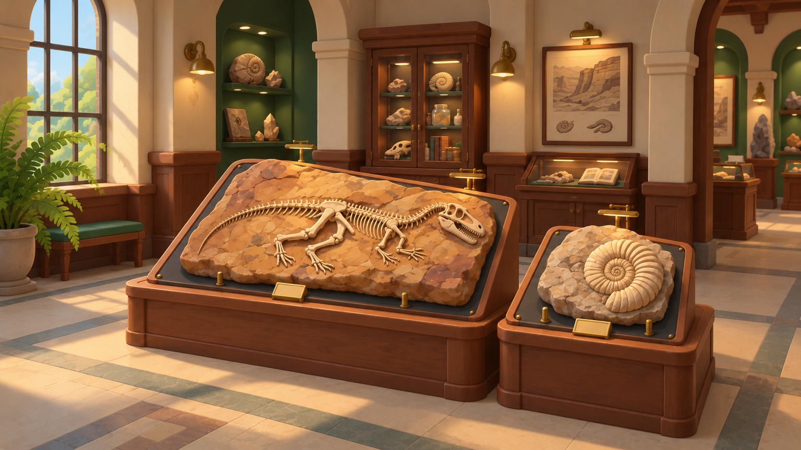
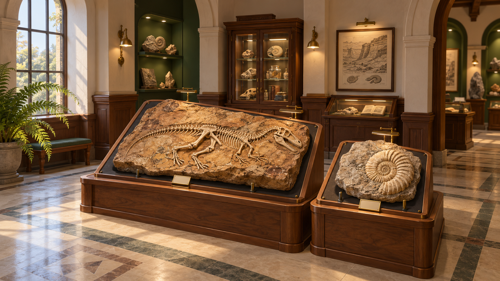

# Musée — direction artistique retenue

Date : 17 octobre 2026. Antoine choisit la seconde direction stylisée, avec
continuité graphique obligatoire avec les préparations déjà validées.
Ce choix de référence ne valide pas encore la future réalisation native.
Retour humain et autorisation courante : [statut canonique](../brain/status.md).

## Intention

Une petite salle d'histoire naturelle accueillante et soignée, où la préparation
du joueur devient une pièce digne d'être exposée. Le musée possède une identité
avant de recevoir le premier bloc ; les acquisitions lui donnent progressivement
une histoire personnelle.

La planche d'origine fournit le bois, le laiton, les cartels et la mise en valeur.
Animal Crossing inspire l'accueil, la lisibilité des formes et le plaisir de voir
la collection prendre place. Les scènes, personnages et assets restent originaux.

## Référence retenue : galerie chaleureuse stylisée

- Une travée avec arches, enduit crème, boiseries et niches vert bouteille.
- Lumière naturelle diffuse et éclairages chauds localisés sur les pièces.
- Matières mates, profils de meubles travaillés, bords adoucis et variation mesurée.
- B–17 et M–08 sur deux supports complémentaires, adaptés à la taille de leurs matrices.
- Cartels discrets, supports mécaniques crédibles, aucun meuble masquant les os.
- Vitrines, illustrations et végétation en second plan ; le bloc reste le sujet principal.
- Une ouverture vers la suite du musée suggère sa taille sans imposer un niveau à parcourir.

L'image guide la composition et l'ambiance du musée. Les fossiles générés,
l'anatomie, la forme des matrices et le décor de collection sont indicatifs :
ils ne remplacent pas nos modèles validés ni le futur résultat réel du joueur.
La facettisation des pierres du concept doit être tempérée pour rester cohérente
avec les matières actuellement validées. La réalisation devra éprouver les
cadrages avec les vrais modèles, dont les angles visibles restent limités.

## Recherche initiale

La première image établit les volumes et la hiérarchie, mais son traitement
photographique, le sol brillant et les microdétails paraissent trop réalistes
pour la direction actuelle. La seconde simplifie les matières et adoucit les formes.
Antoine a ensuite choisi la seconde direction en précisant que les graphismes
doivent rester cohérents avec la préparation.

## Continuité avec la préparation

La préparation validée est la référence pour le traitement des matières et des
spécimens ; le concept 02 guide l'architecture, les volumes et l'ambiance.
Le décor doit accueillir les vrais blocs et leur niveau de détail.

- **Os et ammonite :** garder les modèles, l'ivoire chaud, les variations de
  surface, les sillons, les détails modelés et les ombres qui rendent le relief lisible.
- **Matrices :** garder grain, couleurs, cassures et irrégularités des matières
  validées. La pierre simplifiée en larges facettes dans l'image ne devient pas
  une nouvelle cible de rendu pour les blocs.
- **Mobilier :** silhouettes douces et profils soignés du concept, mais bois
  patiné, métal sobre et textures à une échelle compatible avec l'atelier.
  Éviter le décalage entre un meuble lisse comme un jouet et une préparation détaillée.
- **Lumière :** le contexte d'exposition peut changer l'éclairage ; conserver
  la couleur identifiable des matériaux et des ombres de contact qui révèlent
  les volumes, sans écraser le grain ou rendre les os uniformément blancs.
- **Comparaison :** présenter B–17 et M–08 dans l'atelier et dans la travée,
  avec une taille à l'écran comparable, puis examiner les mêmes détails de près.
  Réutiliser les ressources existantes et harmoniser le décor autour d'elles.

L'essai actuel réutilise déjà les GLB et le shader d'os du projet, mais sa matrice
d'exemple utilise un rendu simplifié propre à la galerie. Cela ne démontre pas
encore une restitution fidèle d'une préparation. Le futur archivage réel,
avec matière restante, nettoyage et dégâts, reste un sujet distinct dans #28.

## Pipeline de réalisation proposé

1. **Fixer la scène.** Confirmer la vue d'ensemble, l'inspection rapprochée,
   les proportions et une palette commune. Conserver le système de caméra et
   les transitions appréciés. Définir les deux gabarits de bloc avec nos modèles.
2. **Concevoir les assets séparément.** Références isolées du présentoir, de la
   vitrine et de l'applique ; vues cohérentes des objets. Un décor entier généré
   en un seul mesh rendrait l'ajustement des supports et des cadrages difficile.
3. **Faire un premier asset Tripo.** Éprouver le présentoir visible de près,
   puis sa qualité dans Godot avant de produire les autres éléments. Préparer
   le plan exact et son coût avant tout appel payant.
4. **Assembler et harmoniser.** Architecture en modules aux dimensions maîtrisées ;
   mobilier et accessoires issus de Tripo, avec retouches au besoin. Vérifier
   topologie, UV, textures, pivots, échelle et normales. Verre, cartels et zones
   d'accueil des blocs restent des éléments distincts et éditables.
5. **Soigner le rendu Godot.** Matériaux cohérents, éclairage, ombres de contact,
   contraste des os et cadrages. Tripo fournit une base d'assets ; la qualité
   de la salle dépend aussi de cet assemblage et de cette direction artistique.
6. **Valider une travée complète.** Une vue d'ensemble et les deux inspections,
   avec B–17/M–08 réels, avant d'étendre le musée ou de multiplier les objets.

### Premier ensemble envisagé
| Élément | Approche envisagée | Rôle |
|---|---|---|
| Présentoir de préparation | Asset pilote Tripo puis adaptation des dimensions/supports | Qualité visible en inspection |
| Vitrine de fond | Asset Tripo séparé, verre géré dans Godot | Identité de musée |
| Applique | Petit asset Tripo réutilisable | Éclairage et cohérence du mobilier |
| Arches, sol, boiseries, niches | Modules de scène aux dimensions maîtrisées | Composition et cadrages |
| Cartels et lit de chaque bloc | Géométrie/texte éditables dans le moteur | Lisibilité et adaptation à la préparation |
| B–17, M–08 et matrice | Modèles existants ; archivage réel à définir dans #28 | Travail personnel du joueur |

Les budgets de géométrie/textures seront fixés sur le pilote et mesurés dans la
scène, en gardant le plafond 240 FPS comme cible. Aucune performance du concept
image ne peut être déduite.

## Revue de la future scène
- La salle attire-t-elle dès la vue d'ensemble, et les blocs restent-ils dominants ?
- Les meubles, la pierre et le métal appartiennent-ils à la même famille artistique ?
- Les détails résistent-ils à l'inspection sans casser la lecture du spécimen ?
- La caméra garde-t-elle le confort déjà apprécié, sans obstacle dans ses trajectoires ?
- Les préparations sont-elles fidèles, y compris les restes de matière et dégâts
  lorsque leur conservation réelle sera raccordée ?

## Provenance
Deux images générées avec l'outil intégré Imagegen, puis revues visuellement.
Prompts exacts : [prompts.json](../visual-references/museum/prompts.json).
La deuxième génération transforme uniquement la direction de rendu de la première.
Aucune génération Tripo, aucun nouveau mesh ni changement de jeu dans cette passe.

## Références du mobilier

Les [quatre images isolées et le guide Tripo](../visual-references/museum/furniture/README.md)
déclinent le concept choisi : deux présentoirs, une vitrine sans verre et une applique.
Le présentoir B–17 est proposé comme premier pilote pour juger le résultat en 3D.
Les références d'objets et le futur modèle restent à examiner ; les dimensions et
matériaux finaux seront ajustés autour des vrais blocs dans Godot.
