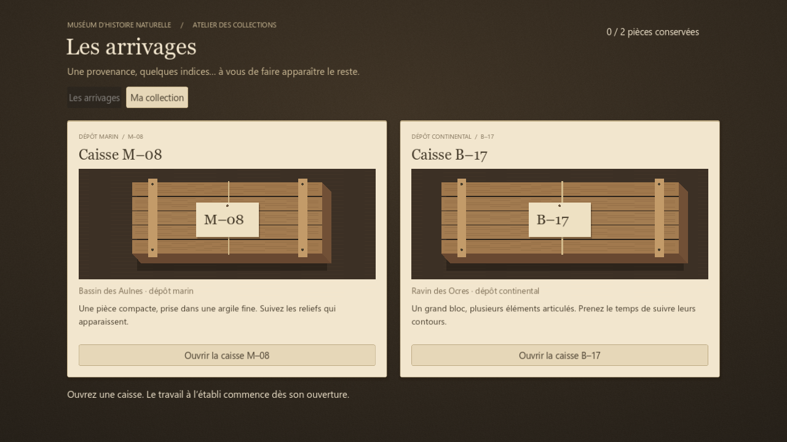
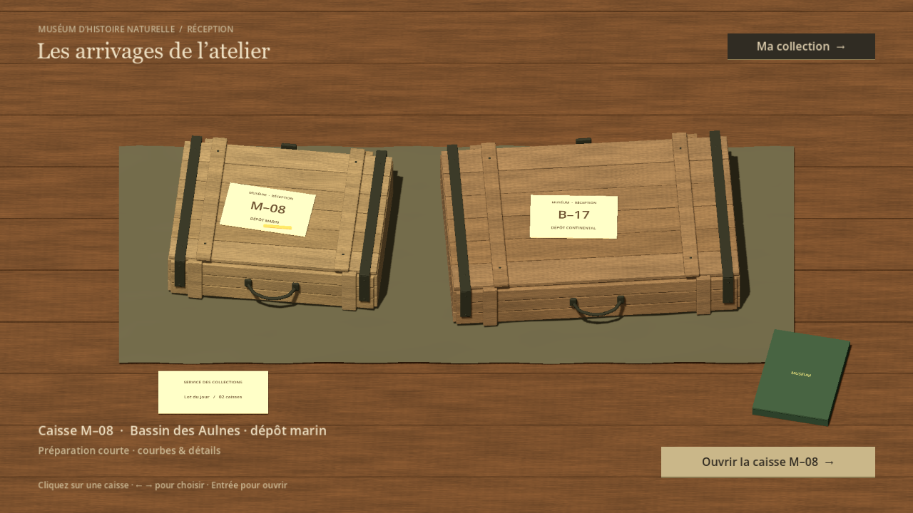

# Issue 27 — Arrivages physiques dans l’atelier

## Problème et résultat

Les grandes cartes d’arrivages donnaient une impression de jeu navigateur.
Deux caisses fermées occupent maintenant un établi en bois sous une lumière
chaude. Un clic sur la caisse ou les flèches choisit la provenance ; un bouton
unique ouvre la sélection, Entrée fait de même sans focus sur une autre action.
Tab parcourt les actions visibles. La préparation en cours propose une reprise.
Aucune animation longue ne retarde l’arrivée à l’établi.

Antoine a accepté la **composition seulement**, avec une réserve explicite sur
la finition visuelle. Les modèles ont ensuite reçu planches séparées, arêtes
adoucies, traverses, ferrures, rivets et poignées courbes. Les matières ont été
revues dans Godot après correction de ferrures trop blanches et de stries trop
régulières. Cette candidate reste soumise à son appréciation artistique.

## Comparaison native

Ancien écran :

Candidate intégrée :

[Format 4:3](evidence/issue27/arrivals-4x3.png) ·
[Préparation à reprendre](evidence/issue27/resume.png)

## Intégration et limites

- Un SubViewport avec son propre monde isole caméra et lumière des arrivages.
  Il cesse de rendre et de traiter la scène lorsque la fouille ou la galerie apparaît.
- Les caisses sont des GLB originaux. Elles ne chargent aucun fossile ni préparation.
  Les étiquettes donnent code et provenance, jamais le contenu encore inconnu.
- La confirmation protège le travail non archivé. Son focus initial va à l’action
  conservatrice ; les raccourcis de sélection restent bloqués pendant la confirmation.
- Sauvegarde, photographie, distinction, outils et règles de fouille restent les
  composants validés. Le nom d’application et le dossier de sauvegarde sont inchangés.
- La collection conserve son interface provisoire. Le registre posé sur l’établi
  est décoratif ; l’action « Ma collection » donne accès à la galerie.
- La scène reprend la famille bois/lumière chaude, sans prétendre terminer la
  direction artistique de tout l’atelier. La toile et les accessoires sont sobres.

## Sources et reproduction

`tools/arrivals/build_crates.py` crée les géométries déterministes avec Blender
5.2.2 LTS et exporte `assets/arrivals/{m08,b17}_crate.glb`. Sources éditables dans
`art/source/arrivals/`. Matériaux de rendu final et décor dans
`scripts/collection/arrivals/arrivals_stage.gd` ; interface dans `arrivals_view.gd`.
Aucun asset externe ou service de génération payant ajouté.

## Vérifications

Godot 4.7.2 stable, renderer Compatibility, RTX 5080 ; données QA isolées.
[Résultats synthétiques](evidence/issue27/checks.json).

| Vérification | Contrôles | Résultat |
| --- | ---: | --- |
| Nouveau parcours natif `run_issue27_arrivals.gd` | 36 | 0 échec |
| Fouille/archivage natif P6A50, mode visual | 32 | 0 échec |
| Invariants M–08/outils/poches P6A50, mode tests | 26 | 0 échec |
| Persistance P6A50 store | 24 | 0 échec |
| Rechargement dans un nouveau processus | 1 | Réussi |
| Chargement des ressources actives | 255 | 0 échec |

Le nouveau parcours injecte de vrais événements clavier/souris : sélection à
960×540, 1024×768, 1440×900 et 1280×720, démarrage, confirmation, annulation au
clavier, reprise identique, ouverture de B–17, galerie et retour. Les scénarios
existants vérifient les outils, la non-révélation, les photos, les distinctions,
les erreurs d’archivage récupérables et les changements de caisse.
Ces vérifications ne constituent pas une validation humaine du résultat.

## Essai humain proposé

Ouvrir M–08 puis revenir aux arrivages ; sélectionner B–17 et annuler le changement,
reprendre M–08, puis confirmer un changement. Juger surtout la présence des caisses,
la cohérence avec la fouille et la clarté de la sélection. La gate courante est
conservée uniquement dans `docs/brain/status.md`.
