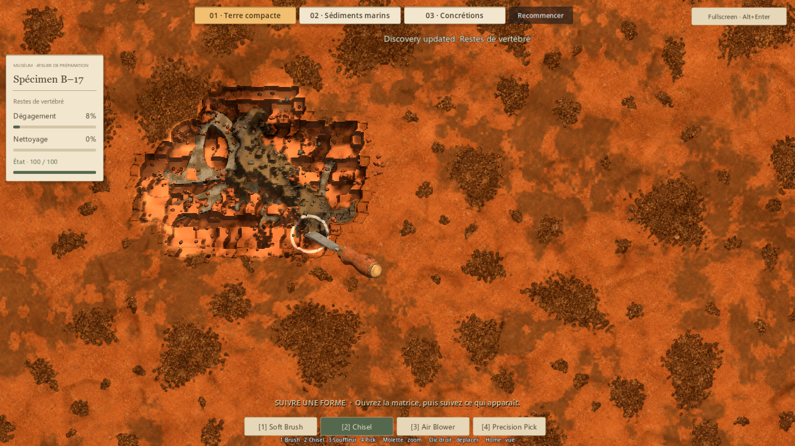
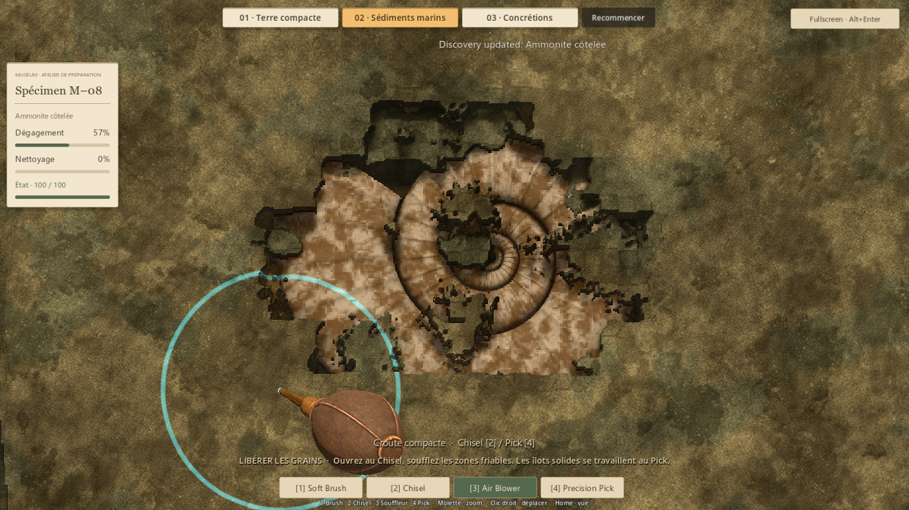
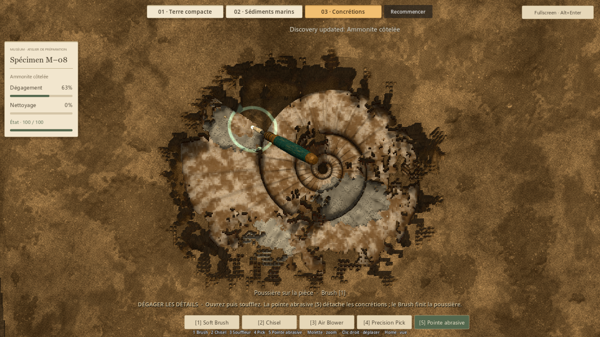
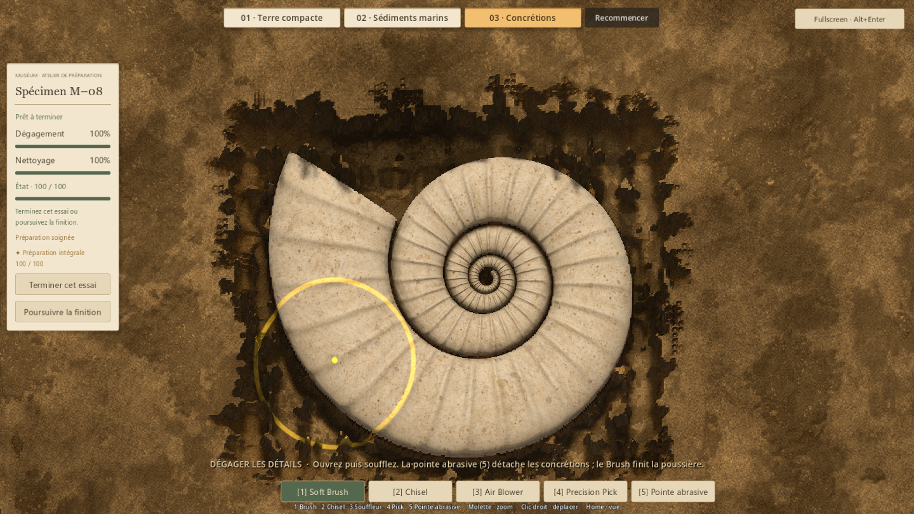

# Trois préparations — livraison de l'essai #33

Référence : main `7feaa4e`, Godot 4.7.2 stable, Compatibility. Le statut et la PR
courante sont dans `docs/brain/status.md`. Vision : `ISSUE33_PREPARATION_DEMOS.md`.

## Résultat jouable

Un lanceur Windows direct et trois essais accessibles depuis le même atelier.
Le passage à un autre essai demande confirmation avant de perdre le travail en
cours. Le résultat peut atteindre 100/100, être terminé, puis recommencé. Les
collections habituelles ne sont pas modifiées ; aucun nouvel écran de caisses.

| Essai | Geste recherché | Réalisation |
| --- | --- | --- |
| Terre compacte, B–17 | Suivre une forme dans une masse | Argile et bancs spatiaux de grès, poche validée, quatre outils conservés |
| Sédiments marins, M–08 | Ouvrir puis libérer | Croûte fermée, grains accessibles au souffle, îlots consolidés à dégager au Pick |
| Concrétions, M–08 | Retrouver un détail masqué | Enveloppe granulaire puis trois dépôts adhérents, pointe abrasive sur 5, film de poussière au Brush |

Les champs de matière ont une épaisseur réelle dans la surface de travail.
Le souffle respecte une photographie des accès au début du pas : il peut
émietter une lèvre directement voisine, pas traverser une couverture distante.
L'abrasif réduit la concrétion jusqu'à la collision réelle, révèle le fossile
sale et conserve sa condition. Il n'excave aucune autre matière. Une protection
de petit fragment empêche le Brush de contourner cette règle.

Les concrétions occupent 3 895 cellules sur 21 389, soit environ 18 % de la
pièce ; leur couverture initiale minimale dépasse 4,5 mm. La forme et la couleur
de la surface fermée ne dépendent pas de leur présence. Les grains sont des
volumes géologiques indépendants de l'anatomie ; le fossile n'intervient que
comme collision lors de leur retrait.

## Revue artistique et itérations

Même atelier, lumière chaude, ombres, modèles ivoire et bords bruts que la base.
La matrice marine reçoit une matière mate gris chaud, des grains ocre et des
îlots plus froids. Les concrétions ont des bords irréguliers, une épaisseur
variable, des pores et une teinte minérale distincte de la poussière.
La pointe possède un profil modelé, des bagues en laiton, un manche émaillé usé
et une extrémité abrasive ; son contact suit la vraie surface.

La première revue native a conduit à réduire le jaune des dépôts, limiter leur
couverture, accélérer l'abrasion et retravailler le manche. Une seconde passe a
ajouté le microrelief des grains, mieux réparti leurs particules et séparé les
commandes, notifications et indications de matière. Ces dernières ne décrivent
que ce qui est réellement découvert sous l'outil. La confirmation est intégrée
au jeu pour conserver un seul espace d'interaction.

Les captures conservées proviennent de vrais contacts via le contrôleur et
d'événements de souris. Aucun reveal/clean de fixture dans le parcours des
captures. Le balayage de test est régulier : son découpage de fouille ne prétend
pas représenter un geste humain artistique ni mesurer une durée de partie.

## Validation

Les résultats détaillés et captures sont dans `evidence/issue33/`.

- Régressions conservées : P1 **52**, P5 **128**, P4V2 **91**, poche P6A49 **197**,
  M–08 P6A50 **26**, stockage **24** ; **518 contrôles, aucun échec**.
- Matériaux expérimentaux : **17 contrôles**, couverture, minuscules concrétions,
  séparation des outils, remise à zéro et absence de propagation instantanée.
- Parcours natifs : **48 contrôles**, trois préparations à 100 % de dégagement,
  100 % de nettoyage et condition 100, archivage de l'essai puis remise à zéro.
- Images identiques avec/sans modèle enfoui ; image identique avec/sans champ
  de concrétions sous la couverture. Ce sont des comparaisons pixel à pixel.
- Interface native : **8 contrôles**, sélecteur, confirmation/cancel, maintien de la fenêtre, touche 5 et protection contre les anciens raccourcis.
- Import final sans erreur ; **267 ressources/scripts chargeables**, aucun échec.
- Les scripts de test utilisent des chemins de sauvegarde sous `work/issue33/`.

Le premier parcours complet B–17 a révélé un balayage automatisé de Brush trop
rapide sur toute la largeur : le test utilise désormais la même vitesse locale
que les courts gestes marins, sans modifier le Brush validé. Les tests d'interface
ont également motivé la confirmation intégrée. Les erreurs intermédiaires sont
corrigées ; seules les dernières sorties sont conservées comme preuve finale.

## Fluidité

Échantillon natif 1 440 × 810 sur RTX 5080 : cap 240 FPS et physique 60 Hz
conservés, image au repos médiane 4,17 ms. Le premier traitement du souffle
coûtait environ 10,6 ms au P95. Une seule traversée, un instantané explicite de
la surface et une table de poids radiaux ramènent le P95 d'édition à **5,22 ms**
(souffle) et **0,96 ms** (abrasif). Le P95 du parcours de rendu actif synthétique
est **12,60 ms**, contre environ 19 ms avant optimisation.

Ce parcours injecte un pas d'outil à chaque image : il est volontairement plus
dense que la physique normale à 60 Hz. Il ne prouve pas 240 FPS constants pendant
la fouille. Les changements de scène demandent encore un court chargement ; ces
mesures restent un point de suivi si ces matières passent en production.

## Captures de revue

## Limites et essai humain

Trois recettes fixes, deux fossiles existants. Aucun générateur global, nouveau
catalogue, économie, métier de conservation scientifique ou Sound Design.
La pointe est sûre dans cet essai, sans nouvelle pénalité d'usure ou de dégâts.
Le budget de contenu et la distribution de production restent à définir. La fouille non terminée n'est pas sauvegardée en fermant l'application.

Tester surtout : la matière suggère-t-elle le bon geste ? Le souffle donne-t-il
le plaisir de libérer une forme ? La concrétion ajoute-t-elle un petit moment
intéressant plutôt qu'une corvée ? Quel essai donne envie de préparer le bloc
suivant ? Le test technique ne tranche pas ces questions.

## Verdict humain — 16 octobre 2026

Antoine valide explicitement l'essai dans son ensemble : les trois approches
apportent une nouveauté appréciée et changent la manière de fouiller. Cette
validation porte sur l'intérêt des mécaniques ; chaque approche mérite encore
une passe de finition ciblée.

- **Terre compacte** : idée retenue, mais le grès domine trop et les poches sont
  trop peu présentes. Rechercher un meilleur équilibre des rencontres, sans
  transformer chaque bloc en la même succession obligatoire.
- **Sédiments marins** : la préparation centrée sur le Blower est appréciée.
  L'ammonite doit offrir davantage de relief réel entre les tours de la
  coquille ; le travail au Pick paraît encore trop plat.
- **Concrétions** : expérience et pointe abrasive appréciées. Le geste est
  cohérent avec le thème et peut constituer une rencontre occasionnelle.
- **Accès aux outils** : Antoine propose des familles sous les mêmes touches :
  par exemple Brush et pointe abrasive sur 1, avec un second appui pour changer
  de variante. La même logique pourrait accueillir une alternative au Chisel
  lorsqu'un usage distinct sera défini. Il ne demande pas encore un outil précis.

Pistes de cadrage à discuter, sans changement de code : creux réels de l'ammonite
cohérents entre modèle, matière à dégager et contact du Pick ; répartition des
poches/grès ; lecture et finition des concrétions. Pour les familles, rendre la
variante active visible et éviter un changement involontaire au retour dans une
famille. Une nouvelle variante doit apporter un geste utile, pas simplement
remplir un emplacement.

La recommandation de commencer par le relief de M–08 reste une proposition :
elle bénéficierait aux préparations marine et encroûtée. Aucun ordre de
développement ni nouveau périmètre n'est validé par ce retour.

## Reproduction

- Double-clic `Launch-Preparation-Demos.cmd`, ou scène
  `res://scenes/experiments/preparation_demos.tscn` avec Godot 4.7.2.
- Import et ressources : `--headless --editor --path . --import --quit`, puis
  `--headless --path . --script tests/run_runtime_resources.gd`.
- Matières : `--headless --path . --script tests/run_issue33_materials.gd -- --qa
  --distinction-store=res://work/issue33/unit-badges.json`.
- Parcours et captures : `--path . --script tests/run_issue33_demos.gd -- visual
  --qa --distinction-store=res://work/issue33/distinction.json`.
- Interface et timings : `--path . --script tests/run_issue33_runtime.gd -- --qa
  --distinction-store=res://work/issue33/runtime-badges.json`.

Les scripts créent leur répertoire de sortie. Les parcours natifs demandent une
fenêtre graphique ; ils ne sont pas des tests headless.
