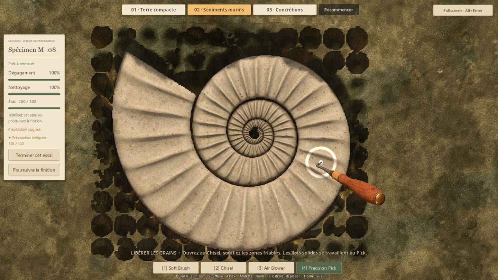

# Ammonite — relief des petites côtes (#35)

## Résultat
La spirale compacte de la référence main est conservée : largeur et espacement
des grands tours, centre et silhouette restent identiques. Le relief ajouté
concerne les petites côtes transversales. Des creux arrondis plus profonds entre
ces côtes donnent du volume à la coquille et une surface réelle que suit le Pick.
Leurs sommets conservent l'enveloppe de hauteur d'origine, avec le même ivoire chaud.

Le modèle, l'occlusion locale par sommets et le champ de contact sont reconstruits
ensemble. Le même asset sert à M–08 habituel, aux sédiments marins et aux concrétions.
Les réglages des outils, des matières, du nettoyage et des dégâts restent identiques.

## Géométrie et contact
Le maillage fermé compte 71 036 triangles, comme la référence. Les 21 389 cellules
du champ de contact correspondent toutes au modèle importé ; erreur maximale
mesurée par un parcours indépendant des triangles : 0,00000000507 m.
Le masque binaire de la silhouette est exactement celui de main 0f505af.

Sur deux petites vagues voisines du même tour, distantes de 7,28 texels, le
dénivelé du champ passe de 2,76 mm à 7,15 mm. Le rayon réel du Pick mesure
7,04 mm entre ces contacts ; la pointe visible reste ancrée au point touché.
Cette mesure porte sur deux côtes voisines, et non sur deux tours de spirale.
Le relief est creusé vers le bas ; la coque ne dépasse jamais son enveloppe
antérieure. La couverture intacte masque toujours le fossile et ses ombres.

## Vérifications
435 contrôles fonctionnels et 268 chargements de ressources passent, zéro échec :

- P1 : 52 ; P4V2 : 91 ; P5 : 128 ; stockage : 24.
- M–08, géométrie et logique de préparation habituelle : 26.
- Matières des essais : 17.
- Trois parcours natifs et vérifications ciblées des petites côtes : 65.
- Parcours natif M–08 habituel, finition et archivage : 32.
- Ressources/scripts chargeables : 268.

Les trois essais atteignent 100 % de dégagement et de nettoyage, condition 100.
Le souffle, le Pick et l'abrasif utilisent les hauteurs reconstruites ; les
concrétions restent distinctes du film de poussière. Les remises à zéro sont
exactes. L'occultation est comparée pixel à pixel avec/sans fossile enfoui et
avec/sans dépôts enfouis.

La préparation habituelle couvre aussi premier contact protégé, finition,
distinction, archivage, échec de sauvegarde/réessai et retour à B–17.
Les sauvegardes de contrôle sont isolées sous work/.

## Captures
Les deux images de comparaison utilisent une même coupe d'inspection mise en
scène, avec caméra et éclairage identiques. Les autres captures viennent des
parcours utilisant les vrais outils.

Référence compacte — coupe d'inspection :

Petites côtes sculptées — même coupe :

Préparation native terminée et contact du Pick dans un petit creux :

Préparation native, abrasion des concrétions :

## Limites et essai humain
Les contrôles vérifient cohérence, accessibilité et non-régression ; ils ne
mesurent pas le plaisir tactile ni une durée humaine de préparation.
Le relief reste adapté à la vue de dessus et à la surface de travail actuelle.
Aucun nouveau benchmark de performance : le nombre de triangles reste celui
de la référence validée, sans affirmation de cadence constante.

Essayer Sédiments marins, puis Concrétions : la spirale retrouve-t-elle bien la
forme appréciée, et les petites vagues donnent-elles désormais envie de suivre
leurs bosses et creux au Pick, sans rendre la finition laborieuse ?

## Reproduction
- Double-clic Launch-Preparation-Demos.cmd, puis 02 ou 03.
- Modèle : tools/p6a50/Build-Ammonite.ps1 (Blender 5.2.2 / Godot 4.7.2).
- Comparaison artistique : tests/run_issue35_relief.gd, arguments utilisateur
  --qa --art-label=ribs --distinction-store=res://work/issue35/qa.json.
- Parcours natifs : même script avec --native --qa
  --distinction-store=res://work/issue33/relief-badges.json. L'espace issue33 est
  attendu par les contrôles hérités ; les preuves vont dans work/issue35/.
- Parcours M–08 : tests/run_p6a50_collection.gd, arguments visual --qa
  --distinction-store=res://work/issue35/ribs-production-badges.json.
- Le JSON natif conserve 65 contrôles et les mesures des deux petites côtes.
  Le message console porte le nom ISSUE33 du harnais de parcours réutilisé.
