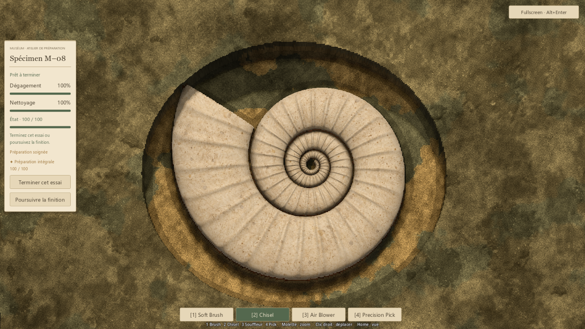
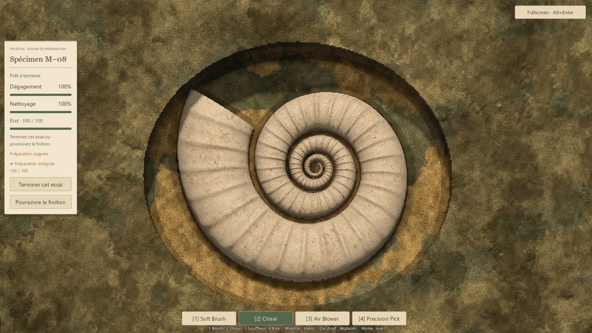
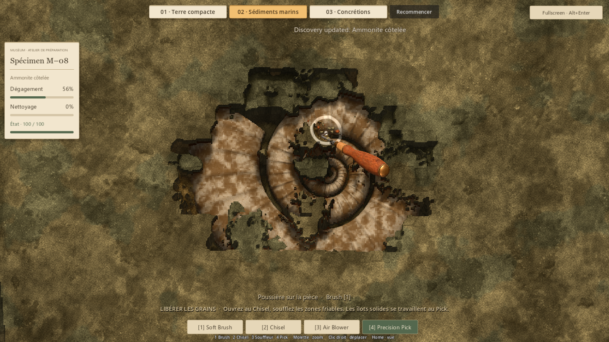
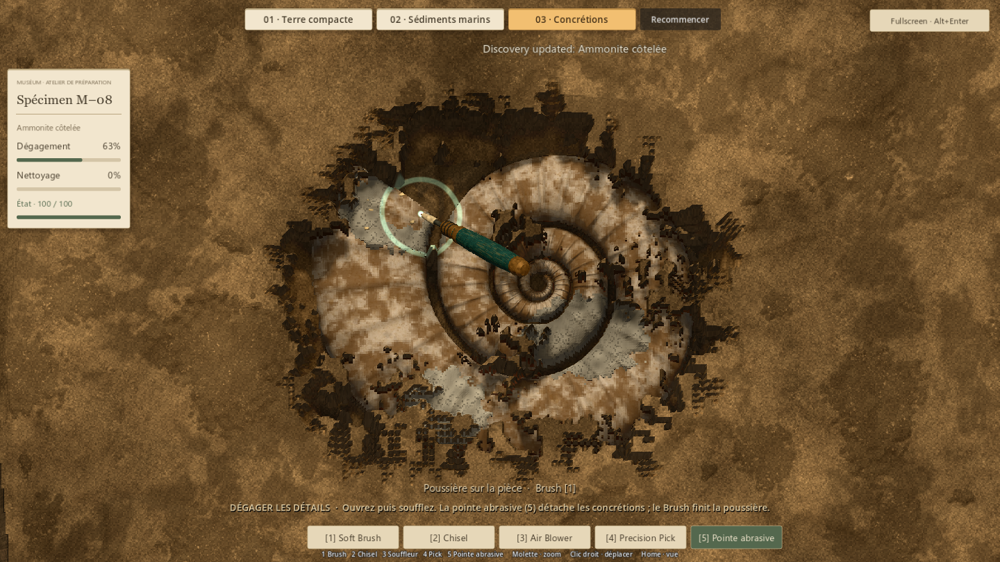

# Ammonite — relief à préparer (#35)

## Résultat
M–08 conserve son ivoire chaud, sa spirale et ses côtes. Les tours sont plus
arrondis, les sillons entre eux plus ouverts et le centre descend davantage.
Les côtes ont une amplitude et un espacement légèrement irréguliers, avec une
lèvre usée. Le changement est dans la géométrie et son champ de contact ; aucun
ombrage peint ne remplace les creux.

Le même modèle sert à la préparation habituelle, aux sédiments marins et aux
concrétions. Les quatre outils validés, l'abrasif expérimental, le film de
poussière, les matières et les critères de fin gardent leurs réglages.

## Travail artistique et cohérence
Une coupe d'inspection identique, explicitement mise en scène, sert de référence
avant/après à éclairage et caméra identiques. La première comparaison montre
surtout l'ouverture du sillon et le volume des flancs. Les captures suivantes
proviennent de parcours avec les vrais outils, sans révélation/nettoyage de fixture.

Le loft source, l'occlusion locale par sommets et le champ de contact sont
reconstruits ensemble. Le nombre de triangles passe de 71 036 à 88 796, sous le
budget existant de 100 000. La source Blender est conservée et la coque est
vérifiée fermée. Les 19 541 cellules du champ correspondent toutes à la géométrie
importée ; erreur maximale mesurée : 0,00000000501 m.

Le sommet du modèle reste plus bas que l'ancien maximum, malgré des flancs
plus volumineux : les tours internes ont été abaissés. L'écart mesuré entre
une crête extérieure et le tour ombilical au contact réel du Pick est de
26,2 mm. Les dépôts expérimentaux gardent au moins 8,33 mm de couverture initiale.
Les silhouettes et leurs ombres restent invisibles sous une couverture intacte.

## Vérifications
434 contrôles fonctionnels et 268 chargements de ressources passent, zéro échec :

- P1 : 52 ; P4V2 : 91 ; P5 : 128 ; stockage : 24.
- M–08, géométrie et logique de préparation habituelle : 26.
- Matières des essais : 17.
- Trois parcours natifs et vérifications ciblées du relief : 64.
- Parcours natif M–08 habituel, finition et archivage : 32.
- Ressources/scripts chargeables : 268.

Les trois essais atteignent 100 % de dégagement et de nettoyage, condition 100.
Après le souffle marin, le test trouve un flanc réel en retrait encore couvert
et l'atteint au Pick, qui s'arrête à sa hauteur de coquille. Les deux contacts
à hauteurs distinctes passent par le véritable rayon du contrôleur. L'abrasif
respecte le nouveau volume, les concrétions restent distinctes du film à brosser,
et les remises à zéro sont exactes. L'occultation est comparée pixel à pixel
avec/sans modèle enfoui et avec/sans dépôts enfouis.

Le parcours de la préparation habituelle couvre aussi premier contact protégé,
finition, distinction, archivage, échec de sauvegarde/réessai et retour à B–17.
Les sauvegardes de contrôle sont isolées sous work/.

Un démarrage graphique est resté bloqué avant initialisation OpenGL alors que
des contrôles headless démarraient simultanément. Seul ce processus de contrôle
a été relancé, avec le même moteur/mode de rendu ; les parcours finaux sont
terminés sans erreur. Aucun processus de jeu utilisateur n'a été arrêté.

## Captures

Avant — coupe d'inspection mise en scène :

Après — même coupe et même cadrage :

Fouille réelle, finition d'un creux au Pick :

Fouille réelle, concrétion sur les volumes de la coquille :

## Limites et essai humain
Les contrôles prouvent la cohérence et l'accessibilité, pas le plaisir tactile.
Les balayages automatiques ne mesurent pas une durée humaine de préparation.
Le relief reste adapté à la vue de dessus et à la surface de travail actuelle ;
ce n'est pas une extraction libre ou une préparation sur toutes les faces.

Aucun rééquilibrage de poches, famille d'outils, nouvel outil, générateur ou
Sound Design dans cette mission. Aucun nouveau benchmark de performance : le
budget de géométrie est respecté, sans affirmer une cadence constante en jeu.

Essayer surtout Sédiments marins, puis Concrétions : les flancs et sillons
donnent-ils réellement envie de suivre la forme au Pick ? Le volume se lit-il
sans rendre la finition plus laborieuse ? Vérifier aussi la préparation M–08
habituelle si la version est retenue.

## Reproduction
- Double-clic Launch-Preparation-Demos.cmd, puis 02 ou 03.
- Modèle : tools/p6a50/Build-Ammonite.ps1 (Blender 5.2.2 / Godot 4.7.2).
- Comparaison artistique : tests/run_issue35_relief.gd, arguments utilisateur
  --qa --art-label=candidate --distinction-store=res://work/issue35/qa.json.
- Parcours natifs : même script avec --native --qa
  --distinction-store=res://work/issue33/relief-badges.json. L'espace issue33 est
  attendu par les contrôles hérités ; les preuves vont dans work/issue35/.
- Parcours M–08 : tests/run_p6a50_collection.gd, arguments visual --qa
  --distinction-store=res://work/issue35/production-badges.json.
- Le JSON natif conserve 64 contrôles et les mesures du relief. Son message
  console porte encore le nom ISSUE33 du harnais de parcours réutilisé.
