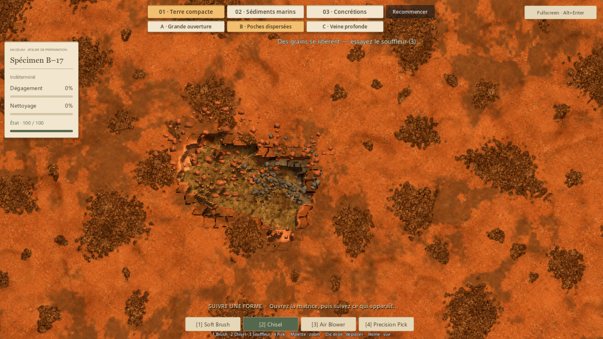
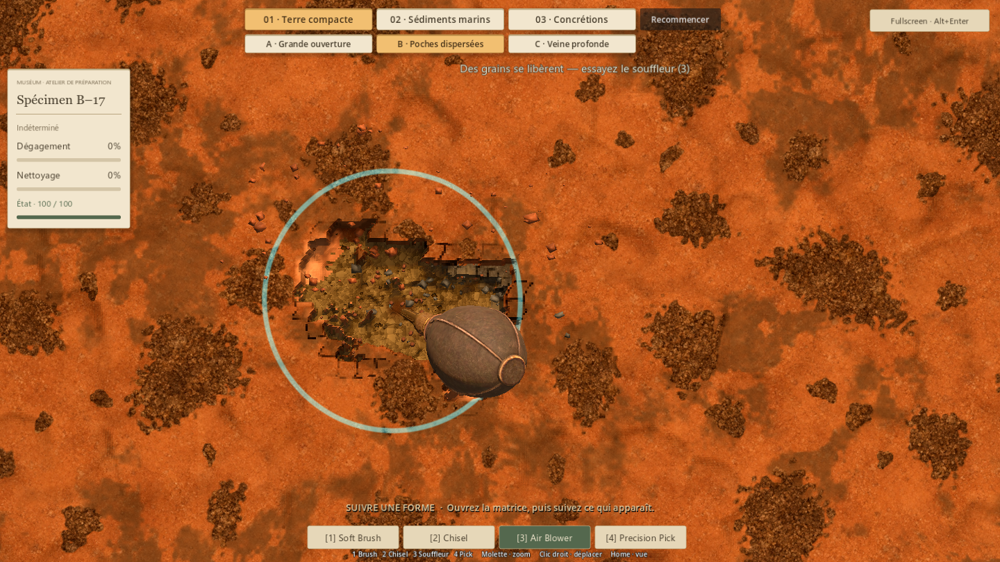
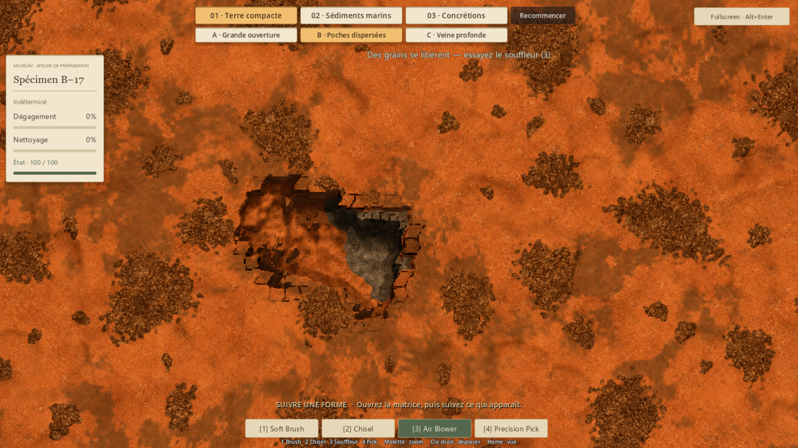
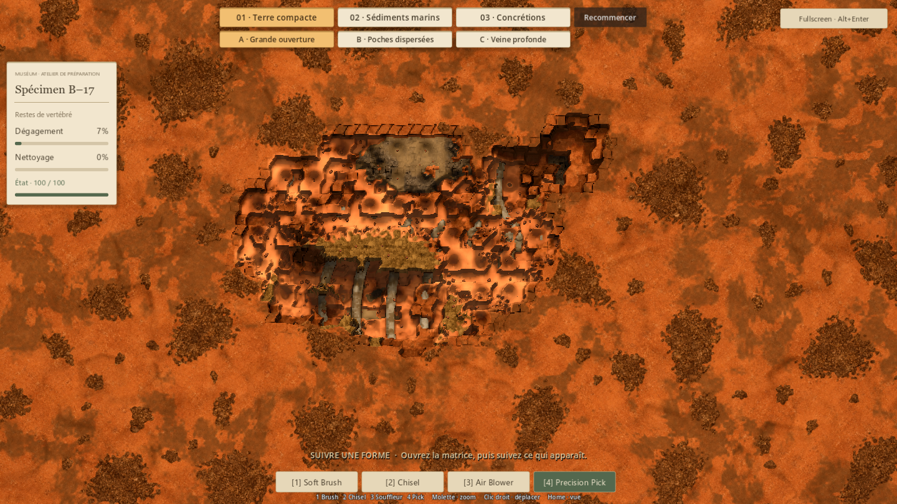
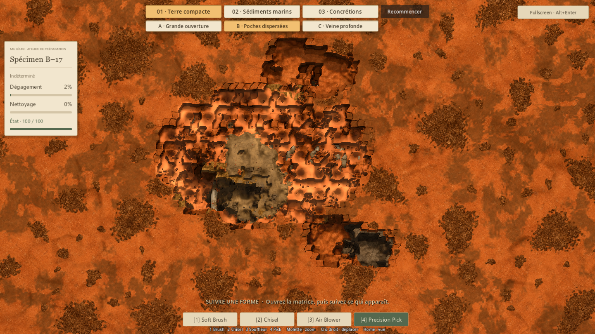
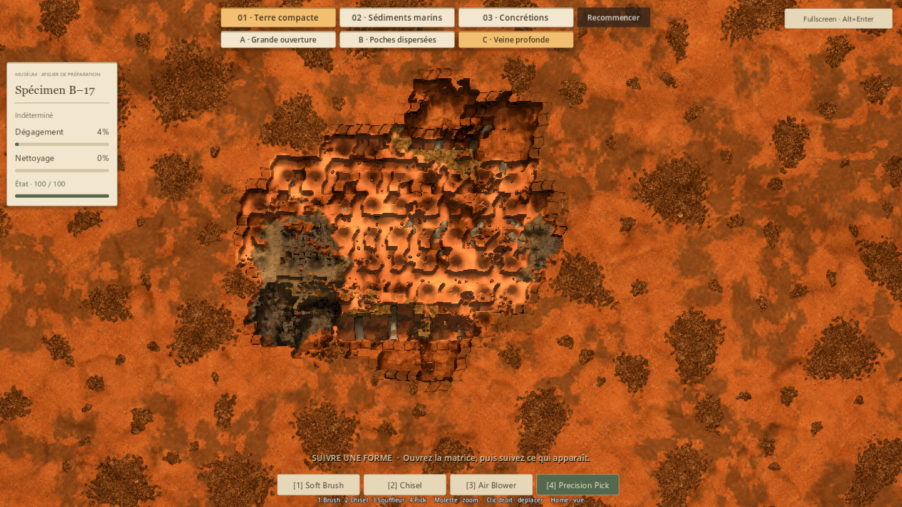
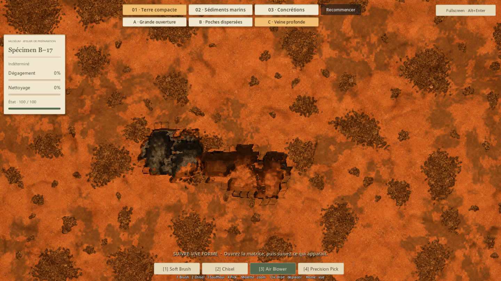
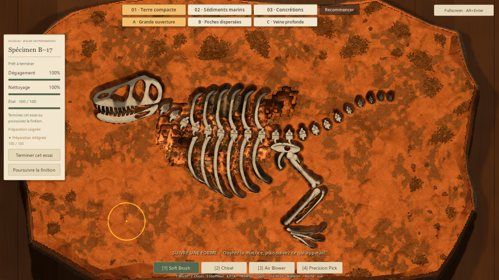

# Terre compacte — trois dispositions (#37)

## Résultat
L'essai compact B–17 propose trois compositions sous le sélecteur existant :

| Disposition | Composition | Intention |
| --- | --- | --- |
| A · Grande ouverture | Une poche large et une plus petite, deux bancs de grès | Gagner une ouverture généreuse, puis une seconde occasion de souffler |
| B · Poches dispersées | Trois poches modestes et des bancs centraux discontinus | Rencontrer plusieurs ouvertures et choisir les zones à relier |
| C · Veine profonde | Une inclusion allongée plus enfouie et une seconde poche | Suivre une direction et alterner souffle et ouverture de la couverture |

Les poches remplacent la matière compacte. Le volume granulaire total varie
de 2 615 à 2 990 unités de champ entre compositions (écart max/min 14,4 %).
Le volume de grès situé au-dessus des cellules du fossile est ramené à environ
25–33 % de celui de l'ancienne recette compacte. Cela laisse des masses de
grès à travailler, avec une dominante argileuse plus rapide à ouvrir.
Ce sont des mesures de composition, pas une équivalence de durée humaine.

## Intégration
Un profil expérimental assemble plusieurs volumes irréguliers dans le même champ
de poche. Le flux à 60 Hz, la limite locale du jet, les grains mats, les
particules et l'assistance sur les derniers grains réutilisent le système validé.
La forme et le fond sont définis avant l'admission : un volume qui rencontre un
os est rejeté entier ; aucune hauteur ni frontière n'est taillée selon l'anatomie.

La couverture minimale initiale dépasse 10 mm. Après retrait des grains,
2,87 mm au minimum de matière compacte protègent encore le fossile dans les
cas contrôlés. La première ouverture centrale arrive en deux impacts de surface
sur A/B, trois sur la veine C ; les outils gardent leurs paramètres.
Le fond présente un vrai relief et peut traverser argile et grès.

Le sélecteur A/B/C apparaît uniquement en terre compacte. Changer ou recommencer
passe par la confirmation existante ; annuler conserve le travail. Recommencer
restaure exactement la disposition choisie. Les essais n'écrivent pas dans
la collection habituelle. Marine, concrétions, outils et assets sont conservés.

## Revue et ajustements
La première répartition a révélé des volumes trop profonds pour leur emplacement.
Le placement a été corrigé avec rejet du volume entier, en conservant le garde
de couverture validé. La poche centrale de B a ensuite été déplacée vers une
zone plus utile : les poches de cette variante recouvrent désormais 2 999 cellules
du fossile, contre 1 884 dans la première composition admise. A et C en recouvrent
respectivement 4 145 et 3 434.

Revue native des surfaces intactes, contacts, premiers jets, cavités,
fouille intermédiaire et finition des trois dispositions. Le gros plan final
montre la transition grains/argile/grès, les particules venant du retrait réel
et leur disparition après relâchement. La comparaison intermédiaire conserve
le même parcours central pour rendre visible le déplacement des bancs.

Toutes les captures proviennent des vrais outils et du contrôleur, sans
reveal/clean de fixture. Les balayages automatiques restent réguliers : certaines
bandes et les contours serrés de la capture à 100 % reflètent ce parcours de
contrôle, pas une forme imposée au joueur ni une mise en scène artistique finale.

## Vérification
654 contrôles fonctionnels, 272 ressources chargeables, aucun échec :

- P1 : 52 ; P4V2 : 91 ; P5 : 128 ; stockage : 24.
- Poche de référence : 197 ; M–08/collection : 26 ; matières des démos : 17.
- Géologie compacte et interactions de surface : 45.
- Trois parcours natifs, occultation, sélection, annulation et redémarrage : 63.
- Grains et mesure native compacte : 3 ; interface marine/concrétions : 8.

Les trois parcours atteignent 100 % de dégagement et de nettoyage, condition
100 et distinction intégrale. Ils utilisent respectivement 3 016, 2 963 et
2 934 impacts dans le parcours automatique commun ; ces nombres ne représentent
pas une cadence ou une stratégie humaine.

La couverture intacte est identique avec/sans modèle enfoui et avec/sans champ
de poche, comparée pixel à pixel dans les trois cas. Le souffle sur la couverture
intacte ne modifie aucune hauteur. Les géométries sont distinctes, sans
chevauchement de volumes, et les remises à zéro sont exactes.

À 1 440 × 810, sur le parcours contrôlé de B : 162 grains dans la capture
de mouvement (limite 176), P95 du traitement de poche 6,02 ms sur 87 pas actifs ;
P95 du contact natif complet 13,83 ms sur 15 impacts. Échantillon limité,
pas une promesse de 240 FPS continus. La nouvelle recette ne change pas le
cap 240 FPS ni la physique 60 Hz.

## Captures
Contact granulaire réel, avant souffle :

Souffle et grains en mouvement :

Même ouverture, fond irrégulier et rencontre argile/grès :

A — fouille intermédiaire :

B — même parcours central, poches et grès déplacés :

C — veine et banc latéral :

C — cavité allongée :

Contrôle de finition complète :

## Essai humain et limites
Lancer Launch-Preparation-Demos.cmd, choisir Terre compacte puis A/B/C.
Fouiller librement, essayer le souffle lorsque des grains se libèrent, et
comparer l'envie de poursuivre ailleurs après une ouverture.

À juger : fréquence utile des poches, place restante du grès, sensation de gain
réel et préférence entre les trois dispositions. La validation technique ne
mesure pas le plaisir ni la surprise d'une découverte non guidée.

Trois compositions reproductibles avec B–17 ; aucun générateur global, nouveau
fossile, outil ou changement de collection. La fouille en cours n'est pas
sauvegardée en fermant le jeu. La fréquence de production et la variété sur
d'autres fossiles restent à définir après cet essai.

## Reproduction technique
- Logique : tests/run_issue37_compact.gd, headless.
- Captures/parcours : tests/run_issue37_compact_native.gd, natif ; --quick
  pour la revue des ouvertures sans finition complète.
- Gros plans/mesures : tests/run_issue37_runtime.gd, natif.
- Tous avec --qa --distinction-store=res://work/issue33/compact-badges.json
  après le séparateur des arguments Godot. Les preuves sont sous work/issue37/.

## Retour humain — 17 octobre 2026

Antoine valide l'essai du commit jouable 313a23d. Il juge le mélange nettement
meilleur que l'ancienne disposition classique : les hauteurs variables,
les bancs de grès locaux et les poches instaurent un rythme et suscitent
l'incertitude sur les rencontres du prochain bloc.

Sa préférence va à **C · Veine profonde**, pour la dynamique « sur quoi
est-ce que je vais tomber ». Les trois dispositions sont retenues ; C sert
de référence de rythme. Ce retour porte sur l'intérêt de l'essai comparatif,
sans trancher la fréquence de production ou une génération globale.
