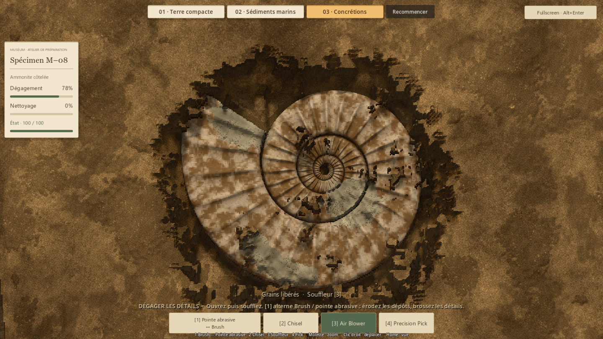
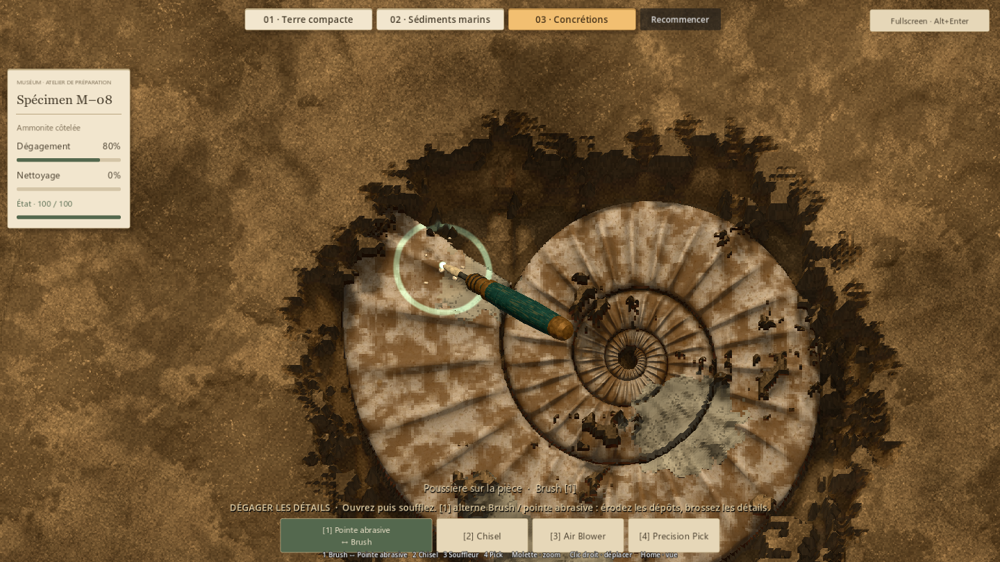
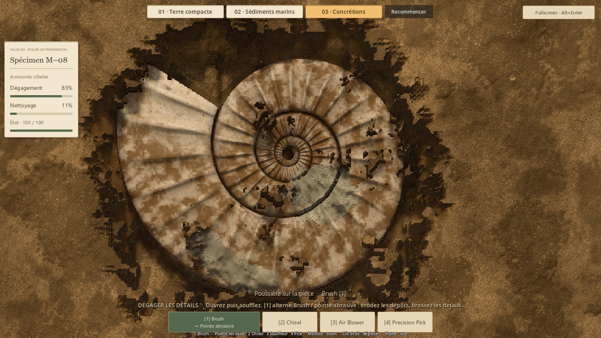
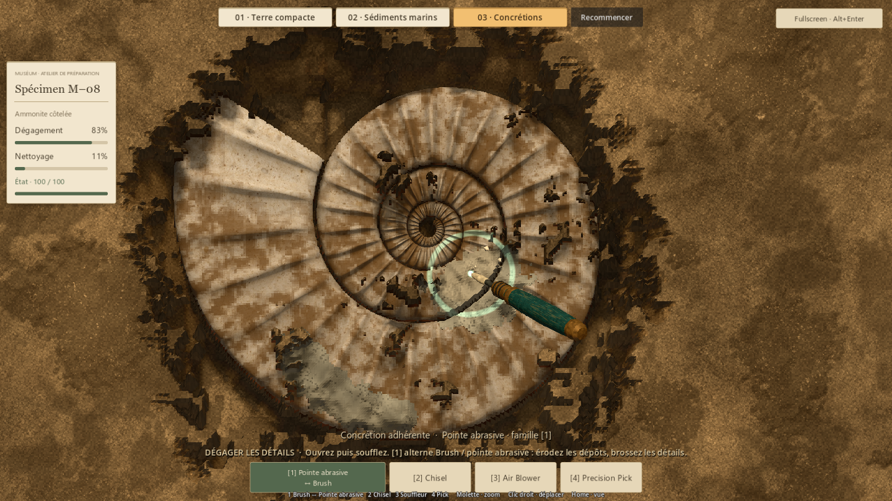
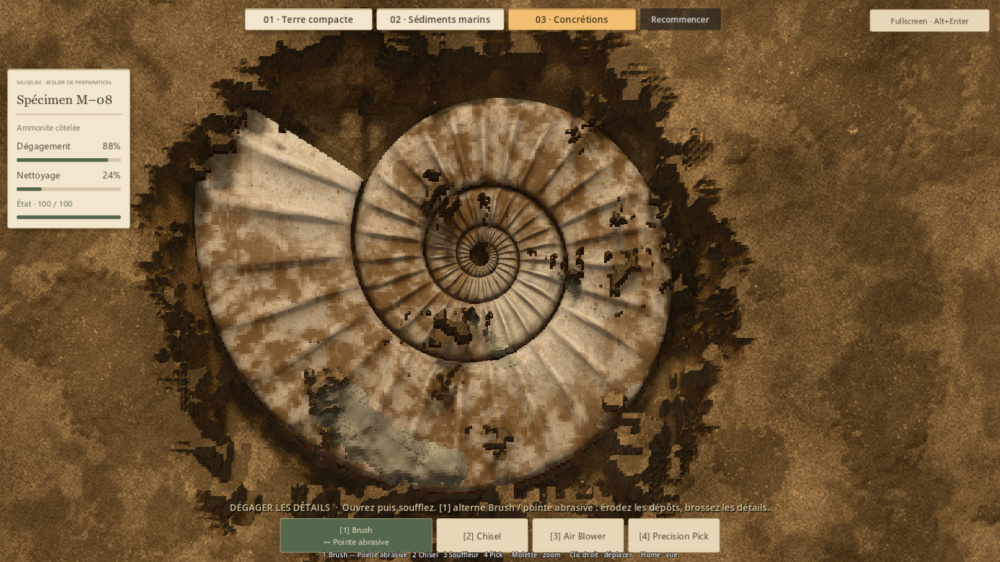
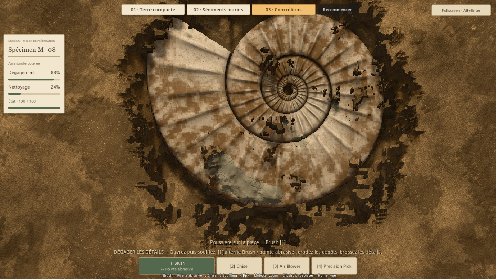
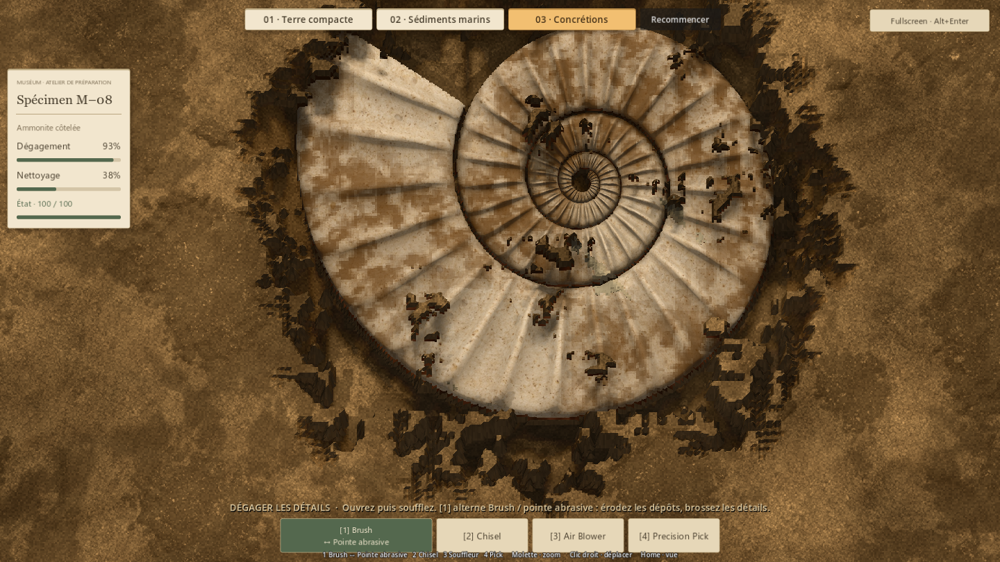
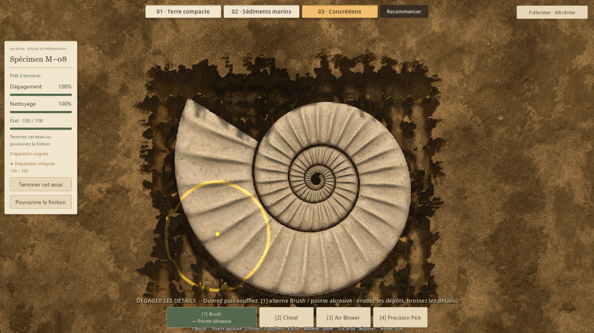

# Concrétions — trois rencontres et finition sur 1 (#39)

## Résultat
M–08 reçoit trois rencontres localisées : voile mince, amas entre plusieurs
côtes et traînée courbe. Les dépôts ont des épaisseurs différentes, des bosses,
des bords amincis et une surface minérale mate. La matière fraîchement abrasée
s'éclaircit légèrement ; son relief suit le retrait réel sous la pointe.

La touche 1 rappelle la dernière variante de finition depuis un autre outil ;
un nouvel appui alterne Brush/pointe abrasive. Le pavé numérique et le bouton
de la barre suivent la même règle. La barre conserve quatre emplacements ;
le premier nomme la variante active et son alternative. La touche 5 ne
sélectionne plus la pointe. Les recettes sans pointe gardent leur Brush simple.

Les particules viennent de cellules réellement retirées. Quelques grains
clairs et une poussière brève accompagnent le contact ; la petite vibration
cesse hors travail effectif. La coquille révélée reste poussiéreuse : le Brush
conserve son rôle et ses paramètres validés. L'abrasif ne gagne aucune capacité
sur la matrice ordinaire ou le fossile.

## Composition et rythme
Les concrétions couvrent 3 479 cellules sur 21 389, soit 16,3 % de la coquille.
La majorité du spécimen reste donc libre de cette finition spécialisée.

| Rencontre | Surface en cellules | Épaisseur réelle | Geste visé |
| --- | ---: | --- | --- |
| Voile mince | 957 | 0,26–2,75 mm | Une côte réapparaît rapidement |
| Amas entre les côtes | 1 309 | 0,52–15,28 mm | Plusieurs reliefs émergent progressivement |
| Traînée courbe | 1 213 | 0,34–6,23 mm | Suivre la courbure et relier les zones libérées |

Le maximum de l'amas inclut le remplissage local de creux de la coquille.
Le voile cède rapidement ; les amas gardent davantage de volume sous le même
outil. Les premières traces natives de 0,12 seconde retirent environ 56 %, 19 %
et 25 % du volume respectif. Après trois passages d'une seconde sur les trajets
contrôlés, il reste moins de 9 % dans chaque rencontre. Ces mesures décrivent
ces trajets précis, pas une durée promise à tous les joueurs.

## Revue et itérations
La première revue montrait des surfaces encore trop plates. Les masses ont été
reprécisées avec des lobes et des remplissages locaux de creux ; les normales
et l'assombrissement local suivent la hauteur réellement visible. Les pores
restent discrets, et la poussière de contact ne masque pas le détail.

La revue a aussi révélé un libellé retardé d'une sélection dans la barre :
la mémoire de variante est désormais mise à jour avant le signal visuel.
Les contrôles vérifient le libellé immédiat dans les deux sens.

Le test complet est séparé du parcours artistique qui brosse chaque rencontre :
il repart d'un bloc intact pour contrôler exposition, poussière et finition.
Aucun reveal/clean de fixture n'est utilisé dans les captures.

## Captures natives retenues
Vue des trois rencontres après ouverture et souffle :

Premier passage sur le voile mince :

Amas avant travail, pendant le contact puis après brossage :

Traînée avant et après finition locale :

Fin du parcours systématique de vérification :

## Vérification
**332 contrôles fonctionnels, 275 ressources chargeables, aucun échec final.**
Détail dans [le bilan](evidence/issue39/summary.json).

- Régression outils P4V2 : 91 ; session P5 : 128 ; terre compacte : 45.
- Matières expérimentales : 17 ; nouveau parcours natif : 43 ;
  interface et timings des démos : 8.
- Couverture intacte identique pixel à pixel avec/sans modèle enfoui et
  avec/sans matière de concrétion ; couverture physique minimale de 6,08 mm.
- Air/abrasif sans effet à travers la couverture. Brush, Pick et air
  ne contournent pas les dépôts, même minuscules.
- Alternance, mémoire, pavé numérique, répétition clavier, barre réelle,
  interruption de geste, modale, archive et reset vérifiés.
- Finition 100 % de dégagement, nettoyage arrondi à 100 %, condition 100,
  préparation soignée et distinction intégrale accessibles avec les outils.
- Grains et poussière transitoires ; aucune nouvelle écriture de collection.

Mesures natives à 1440×810 sur RTX 5080, Compatibility : abrasion P95
0,907 ms sur 383 pas actifs dans les rencontres. Le parcours existant des démos
relève 1,018 ms pour l'abrasif, 5,435 ms pour l'air ; images au repos P50
4,166 ms / P95 4,197 ms. Le parcours actif synthétique atteint 13,046 ms au P95.
Ce ne sont pas des garanties de 240 FPS continus ; cap et physique restent inchangés.

## Essai humain et limites
Lancer Launch-Preparation-Demos.cmd et choisir **03 · Concrétions**.
Ouvrir, souffler, puis essayer les trois zones en alternant la finition sur 1.

À juger : reconnaissance des dépôts, plaisir de voir les côtes se dégager,
rythme des petits passages et confort du retour à la dernière variante.
La revue technique et artistique interne ne remplace pas ce verdict.

Trois rencontres composées sur le même spécimen, sans génération aléatoire
de production. Aucun changement de collection, son, dommages, outils de base
ou géologie des autres préparations. La fouille reste en mémoire jusqu'à
fermeture du jeu. Le parcours complet de contrôle est volontairement
systématique ; son contour de fouille ne représente pas un parcours humain.

## Reproduction
- Import : Godot 4.7.2 --headless --editor --path . --import --quit.
- Chargement : tests/run_runtime_resources.gd, headless.
- Matières : tests/run_issue33_materials.gd, headless.
- Terre compacte : tests/run_issue37_compact.gd, headless.
- Parcours/captures : tests/run_issue39_concretions_native.gd, natif.
- Interface/timings : tests/run_issue33_runtime.gd, natif.
- Démonstrations avec --qa --distinction-store=res://work/issue39/badges.json
  après le séparateur des arguments Godot ; sorties locales sous work/issue39/.
