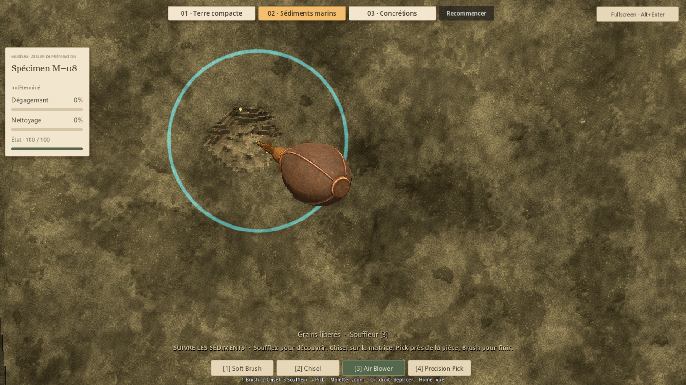
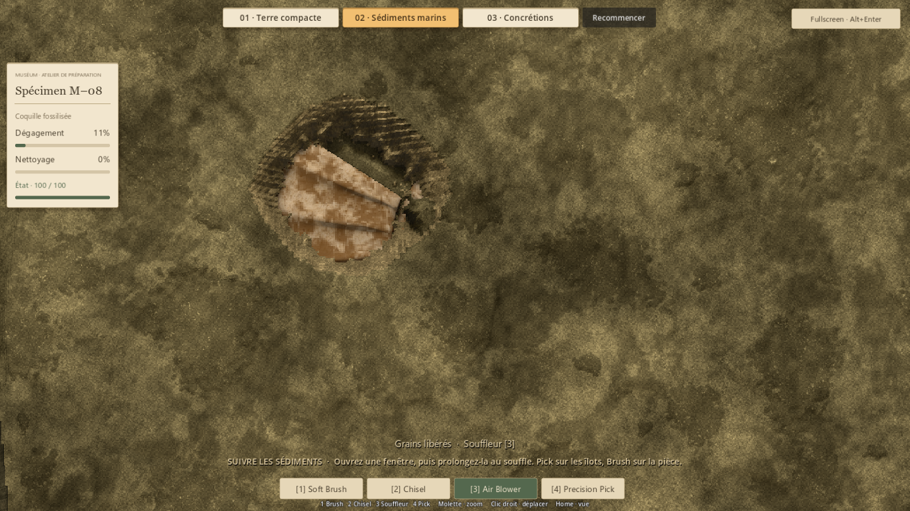
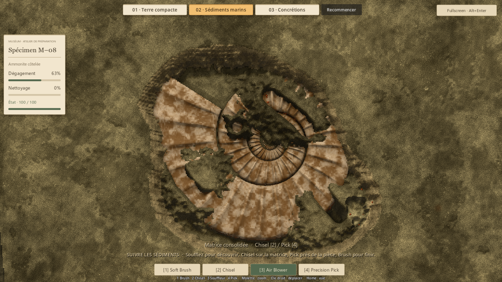
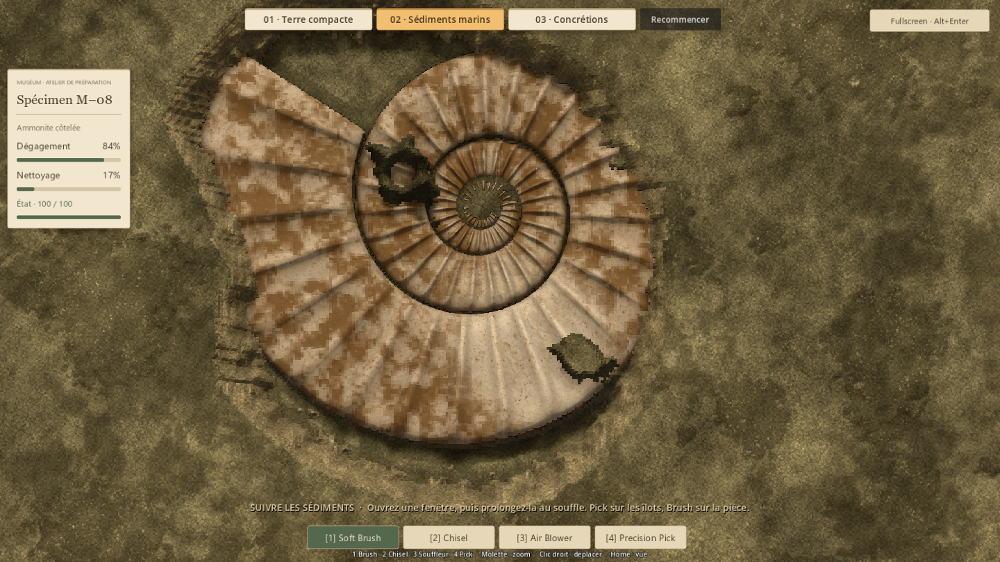
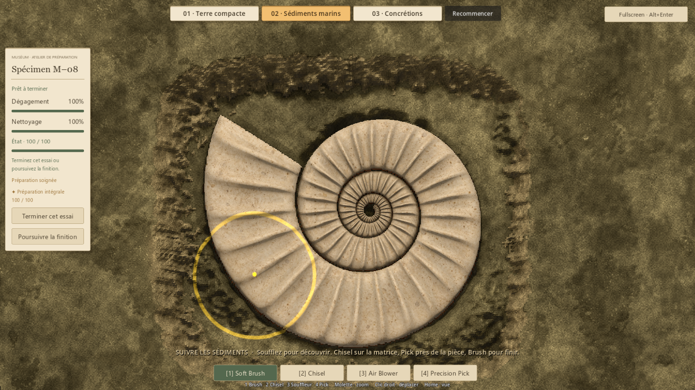

# Sédiments marins — découverte au souffle, préparation sur bancs durs (#41)

> Rapport de la correction précédente (9fb752f). Le nouvel essai de parcours
> est documenté dans [ISSUE41_MARINE_JOURNEY_REPORT.md](ISSUE41_MARINE_JOURNEY_REPORT.md).
> Ses mesures et captures ne remplacent pas celles conservées ici.

## Résultat et retour humain
Antoine valide le feeling du Blower et la réaction de matière, mais juge la
préparation trop courte : environ 30 secondes lors de son essai. Cette correction
conserve le souffle et renforce le travail après la découverte.

Une ouverture dans la croûte donne accès à la même nappe granulaire. Le souffle
révèle rapidement une partie reconnaissable de l'ammonite, puis rencontre trois
bancs consolidés irréguliers qui recouvrent la coquille et débordent autour.
Le Chisel dégage les masses éloignées de la pièce ; le Pick permet d'en suivre
les côtes. Le Brush termine le film adhérent.

Les bancs ont des épaules progressives et des épaisseurs différentes. Des passages
meubles subsistent entre eux, avec l'accumulation profonde précédente. Les volumes
utilisent uniquement les positions et des bruits déterministes, sans consulter
l'anatomie cachée. La collision rencontre le relief réel pendant le retrait.

Le débit, la cohésion des grains, les particules, les outils, leurs cadences et
les dégâts restent ceux de la version testée. L'aide de la préparation rappelle
la succession souffle → matrice → précision → brossage.

## Retour humain sur la correction
Antoine confirme que les bancs durs correspondent à la modification imaginée.
Après essai, il rapporte toutefois une préparation terminée en 1 min 30 à 2 min,
encore trop rapide à son goût. Ce verdict valide la structure et le feeling,
mais laisse ouverte la question du parcours. Antoine confirme ensuite une
cible de 5–7 minutes pour ce petit spécimen ; d'autres pièces pourront être
plus longues. Les leviers précis restent à cadrer. Les chiffres de QA
ci-dessous restent des contrôles techniques, distincts de cette durée humaine.

## Revue native
Les captures montrent la découverte, les masses qui résistent au souffle et la
reprise progressive au Pick. Le parcours de précision a été revu pour suivre des
traits continus le long des côtes : une première sonde sur des points isolés
creusait surtout des trous et n'exerçait pas assez la progression latérale.
La séquence finale passe tous ses contrôles et conserve une condition de 100.

### Premier contact et découverte rapide

### Matrice dure sous la nappe, puis reprise précise

### Finition distincte, puis pièce complète

## Vérifications de la correction
- Comparaison de deux préparations fraîches avec le code précédent : couverture,
  toit granulaire et cohésion strictement identiques ; seuls les fonds consolidés
  sont relevés dans les nouveaux bancs. Aucun fond abaissé.
- Couverture intacte identique pixel à pixel avec le modèle et son ombre masqués.
- Croûte distante protégée, propagation locale et aucune cascade dans un même tick.
- Souffle prolongé sans érosion des bancs ; Chisel capable de les tailler autour
  de la coquille ; progression réelle au Pick avec condition intacte.
- Séparation grains/matrice/film, arrêt sur le relief, archive et reset exacts.

La géologie laisse **12 741 cellules sur 21 389 (59,6 %) accessibles au souffle**,
contre 94,4 % avant ce retour. Environ 40 % demandent donc du travail solide.
Sur le même parcours composé, une ouverture au Chisel puis les passages au
souffle donnent **51,7 % de dégagement**, contre environ 83 % auparavant.
La reprise partielle Chisel/Pick atteint ensuite 63,2 %, avec du travail encore
visible. Ces parcours connaissent la disposition ; ce ne sont pas des mesures
de durée humaine.

Le parcours intégral, distinct et systématique, utilise les outils réels sur
un départ neuf : dégagement 100 %, nettoyage arrondi à 100 %, condition 100.

**326 contrôles fonctionnels rejoués et 279 ressources chargeables : aucun échec.**
Détail : marine native 31, matières marines 14, matières des démos 17, terre
compacte 45, P4V2 91, P5 128. La précédente régression native des concrétions
(43 contrôles) est conservée comme preuve de la première passe ; elle n'a pas
été rejouée ici, son code et les mécaniques partagées étant inchangés.

Preuves : [summary.json](evidence/issue41/summary.json),
[native.json](evidence/issue41/native.json), [materials.json](evidence/issue41/materials.json)
et [comparaison des champs conservés](evidence/issue41/baseline-comparison.json).

## Limites et essai humain
La composition reste déterministe. Les particules illustrent le volume retiré ;
elles ne simulent pas individuellement chaque grain du bloc.
Les coûts d'édition au souffle sont consignés dans native.json (P95 7,79 ms sur
ce parcours). Ils ne mesurent ni la latence souris-écran ni une garantie de
240 FPS continus. La passe fluidité/réactivité reste une mission distincte.

Essai : **Launch-Preparation-Demos.cmd → 02 · Sédiments marins**.
Ouvrir une fenêtre et suivre la nappe au souffle. Reprendre les bancs au Chisel
sur leur périphérie et au Pick près de la coquille, puis brosser les zones
préparées. Évaluer surtout si la découverte reste immédiate et si la suite
apporte assez de préparation précise, sans devenir une corvée.

## Reproduction
Godot 4.7.2 stable, rendu natif Compatibility, fenêtre 1440 × 810.
- tests/run_issue41_marine_native.gd : parcours, captures, archive et reset.
- tests/run_issue41_marine_materials.gd : volumes et règles de retrait.
- tests/run_issue33_materials.gd et tests/run_issue37_compact.gd : autres matières.
- tests/run_p4v2_tests.gd, tests/run_p5_tests.gd, tests/run_runtime_resources.gd.

Arguments après le séparateur Godot : --qa et
--distinction-store=res://work/issue41/review1/badges.json.
Sorties locales sous work/issue41 ; régressions dans leurs répertoires habituels.
L'audit ponctuel compare deux scènes neuves, dont une avec marine_profile.gd
extrait du commit 10a5acf ; recréer un profil sur une surface déjà appliquée
ne fournit pas une base de comparaison valide.
