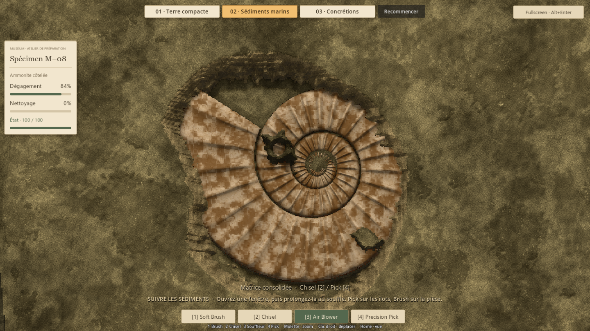

# Sédiments marins — une fenêtre, une nappe, le relief (#41)

## Résultat
La préparation M–08 conserve ses quatre outils et leur réglage validé.
Une ouverture dans la croûte donne accès à un lit granulaire continu.
Le souffle prolonge cette ouverture et descend dans la matière ; quelques
lentilles consolidées interrompent localement le parcours. Le Pick travaille
ces îlots, puis le Brush nettoie le film adhérent de la coquille.

Les volumes géologiques utilisent uniquement les positions et des bruits
déterministes. La croûte n'épouse pas l'anatomie cachée. Le retrait rencontre
le relief réel de la coquille et laisse les creux se découvrir progressivement.
Aucun changement du modèle, des dégâts, des cadences ou de la collection.

## Revue visuelle et itérations
La première version permettait déjà une progression continue au souffle,
mais ses parois étaient trop régulières et les îlots avaient un dessus plat.
La seconde version ajoute une variation locale de cohésion du sédiment ;
la couverture mince se prolonge au-dessus des lentilles, dont les épaules
sont amincies. Le souffle découvre leur volume au lieu de laisser une
pastille de croûte intacte.

La matière libérée reçoit un sable gris chaud, un relief d'éclairage lié
à la hauteur actuelle et des grains de plusieurs tailles. Quelques grains
roulent avant l'éjection. Les émissions partent de cellules effectivement
retirées, y compris pour un tout petit contact. La poussière est brève,
de façon à laisser lire la modification. Les retours et teintes des poches
de terre compacte et des concrétions restent séparés.

Le parcours de capture au Pick suit trois points sur l'îlot, plutôt que
d'insister uniquement au centre. Les captures proviennent du moteur natif
avec les vrais outils ; aucune fixture de révélation ou de nettoyage.

### Premier souffle et ouverture prolongée

### Nappe et îlots restant à travailler

### Finition des côtes et préparation complète

## Vérifications
La couverture intacte est comparée pixel à pixel avec le modèle et son ombre
masqués. Les tests vérifient également :
- impossibilité d'ouvrir une croûte intacte au blower ;
- propagation uniquement depuis un bord découvert, sans cascade dans le même tick ;
- changement local dans l'empreinte, effet nul à durée nulle ;
- arrêt sur le noyau consolidé et sur la surface réelle du fossile ;
- rôles distincts du souffle, du Pick et du Brush, condition intacte ;
- réinitialisation exacte, archive réelle et préparation intégrale atteignable.

Le lit granulaire permet au souffle d'atteindre 20 198 des 21 389 cellules
du fossile (94,4 %) ; les lentilles laissent une part locale de finition solide.
Sur le parcours composé, une ouverture au Chisel puis de courts passages
continus au souffle révèlent environ 83 % de la pièce. Ce parcours de contrôle
connaît la disposition ; il ne mesure pas la durée d'une découverte humaine.
La finition intégrale utilise un balayage systématique aux outils réels
sur un départ neuf. Dégagement 100 %, nettoyage arrondi à 100 %, condition 100.

**365 contrôles fonctionnels et 279 ressources chargeables : aucun échec final.**
Les concrétions (43 contrôles natifs), la terre compacte et les systèmes P4/P5
passent leurs régressions.

Contrôles et mesures exactes : [summary.json](evidence/issue41/summary.json),
[native.json](evidence/issue41/native.json) et
[materials.json](evidence/issue41/materials.json).

## Limites et essai humain
Il s'agit d'une composition d'essai. Le lit et les îlots sont déterministes ;
ce n'est pas encore un générateur de préparations de production.
Les grains visibles sont un retour transitoire sur le volume retiré, pas une
simulation volumétrique de chaque particule de sable.

Les coûts d'édition du blower sont consignés dans native.json. Ils ne sont
pas une mesure de latence souris-écran ni une garantie de 240 FPS continus.
Le suivi des outils, la physique 60 Hz et le plafond de rendu 240 FPS restent
inchangés. La passe fluidité demandée est une mission suivante distincte.

Essai : Launch-Preparation-Demos.cmd → **02 · Sédiments marins**.
Ouvrir une fenêtre, prolonger l'ouverture au blower, contourner un îlot puis
le reprendre au Pick. Finir quelques côtes au Brush. Juger la lisibilité de
la matière qui cède, l'envie de poursuivre le souffle et le rythme des reprises
au Pick. La validation technique et la revue interne restent distinctes
du verdict humain.

## Reproduction
Godot 4.7.2 stable. Tests de matières, P4/P5 et ressources en headless ;
captures et parcours en rendu natif Compatibility, fenêtre 1440 × 810.
- tests/run_issue41_marine_materials.gd
- tests/run_issue41_marine_native.gd
- tests/run_issue33_materials.gd
- tests/run_issue37_compact.gd
- tests/run_issue39_concretions_native.gd
- tests/run_p4v2_tests.gd et tests/run_p5_tests.gd
- tests/run_runtime_resources.gd

Arguments de test après le séparateur Godot : --qa et
--distinction-store=res://work/issue41/badges.json.
Sorties locales sous work/issue41 ; les tests de régression conservent leur
répertoire historique. Un premier passage natif s'est interrompu dans
l'attente de la séquence de capture ; il a été arrêté puis relancé avec des
repères de progression et un délai maximal. Le parcours final a réussi
entièrement (27 contrôles), y compris le retrait au Pick, l'archive et le reset.
