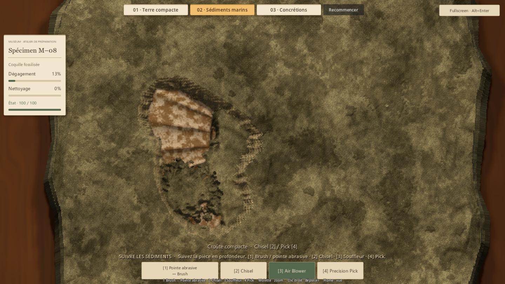
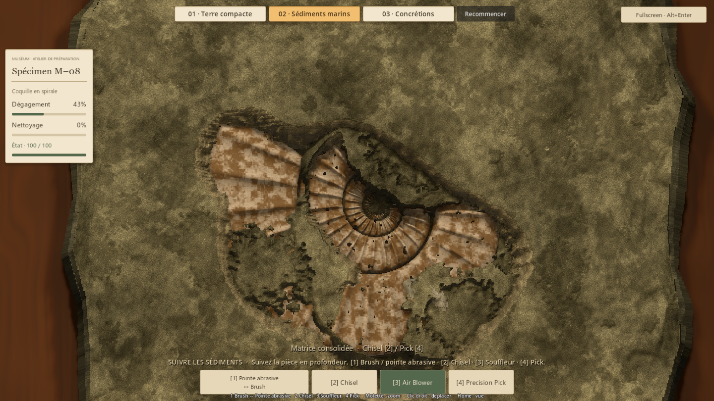
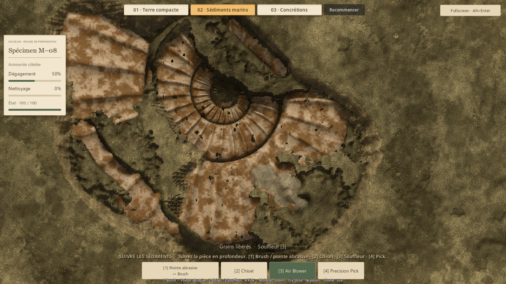
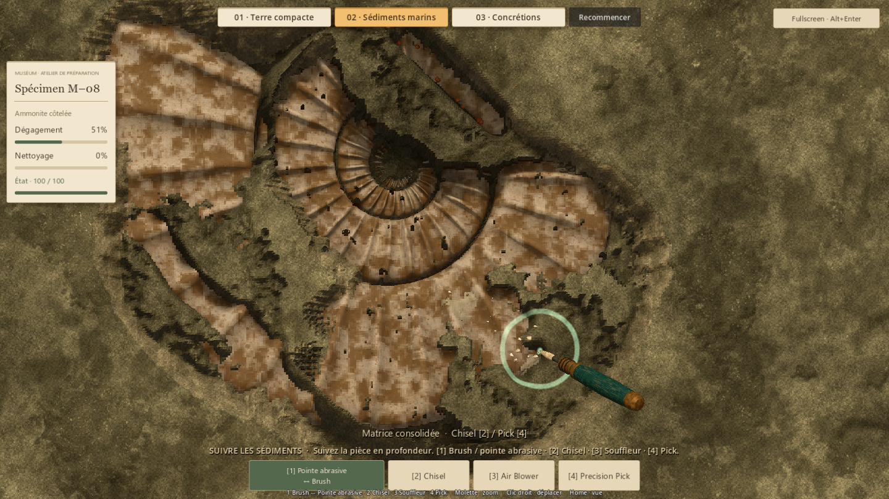
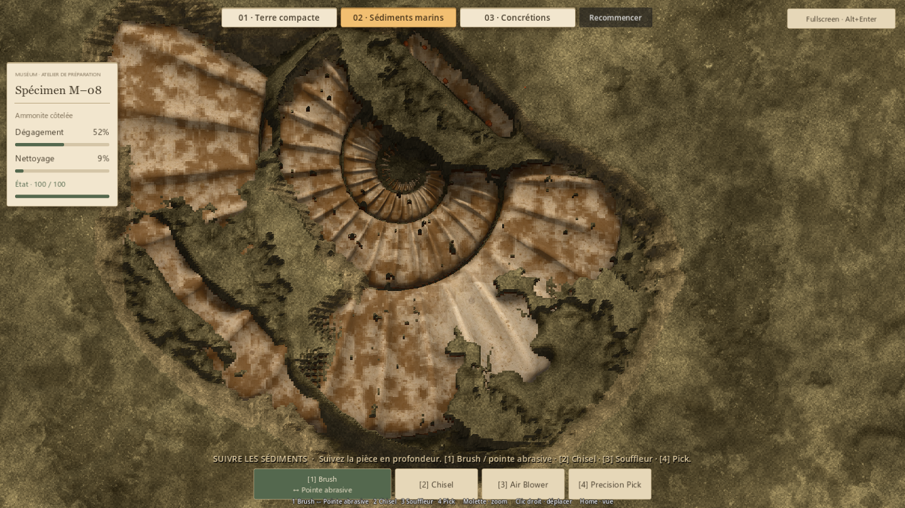
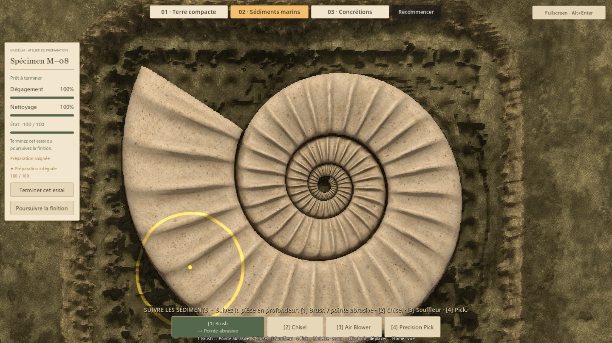

# Parcours marin en profondeur — essai #41

## Résultat proposé
La découverte rapide ouvre maintenant un parcours plus ample : une partie de
l'ammonite apparaît sous la première nappe, puis des accès dans la matrice donnent
sur des lentilles meubles plus profondes. Les épaules solides demandent une reprise
au Chisel/Pick. Un petit groupe de concrétions termine la partie profonde avec la
pointe abrasive, puis le Brush retire le film.

La cible approuvée est **5–7 minutes pour cette ammonite**, après un essai humain
précédent terminé en 1 min 30 à 2 min. Ce nouvel essai prépare cette évaluation :
aucune durée humaine n'a encore été mesurée sur cette composition.

## Composition et contact réel
- Sculpture approuvée conservée, placement marin agrandi ×1,4 et incliné de 4,3°.
  La surface de préparation passe de 21 389 à 41 846 cellules. Le relief entre les
  petites côtes, la spirale compacte et l'ivoire chaud proviennent du même source.
- Modèle, champ de dégagement et contact triangulaire dérivés du même placement.
  Les autres préparations gardent leurs modèles et champs précédents.
- Couverture bombée et trois bancs irréguliers définis par l'espace et des bruits
  déterministes, indépendamment de l'anatomie. Au départ, au moins 11,81 mm de
  matière couvrent le fossile ; les concrétions restent elles aussi enfouies.
- Deux niveaux meubles séparés par une matrice consolidée. L'air s'arrête sur
  cette séparation ; ouvrir un accès rend le souffle utile à nouveau. La propagation
  locale consulte la couche concernée et l'état avant le contact, sans cascade
  à travers une couverture intacte dans le même tick.
- Trois petits lobes adhérents regroupés sur une seule zone de côtes profondes
  (environ 2,4 % des cellules du fossile). La famille 1 réutilise Brush/pointe
  abrasive, avec rappel de la variante et alternance au second appui.

Le débit et la cohésion des grains, les effets au contact, les rayons, puissances,
cadences et dégâts des outils sont conservés. L'épaisseur et le placement des
matières composent le parcours ; aucun minuteur ne ralentit la préparation.

## Revue et itérations
Une première couverture profonde trop uniforme produisait surtout des ouvertures
isolées. Elle a été remplacée par des lentilles meubles enterrées avec des marges
progressives. Le parcours de revue dégage d'abord le lit supérieur, ouvre les
séparations, puis reprend le souffle dans les nouveaux passages. Les concrétions
ont été fractionnées en petits lobes pour éviter une grande plaque uniforme.

Les captures suivantes proviennent des outils réels, sans révélation forcée.

Sur le parcours composé, la première ouverture atteint 13,9 % de dégagement,
puis les accès profonds 43,8 %. Les reprises locales atteignent 52,3 %, en laissant
encore de la matrice à préparer. Environ 64,2 % des cellules pourront être atteintes
par les lits meubles une fois leurs accès ouverts ; ce chiffre inclut les lentilles
enterrées et ne décrit pas ce que révèle le premier passage au souffle.

## Vérifications
- Marine native : 31 contrôles ; matières marines : 21.
- Matières des démos : 17 ; terre compacte : 45.
- P4V2 : 91 ; P5 : 128 ; concrétions natives et familles d'outils : 44.
- Ressources runtime : 282 chargeables.

**377 contrôles fonctionnels et 282 contrôles de ressources, aucun échec.**
La régression concrétions vérifie maintenant la famille marine et conserve un
contrôle du slot Brush seul en terre compacte.

La couverture intacte reste identique pixel à pixel quand le modèle et son ombre
sont masqués, ou quand le champ des concrétions est neutralisé. Le souffle ne perce
pas les séparations solides ; le Pick permet de rejoindre le lit inférieur.
L'abrasion et le film restent distincts. Le parcours intégral aux outils réels
atteint dégagement 100 %, nettoyage arrondi à 100 %, condition 100, puis archive
et réinitialisation exacte. Les réinitialisations restaurent aussi les deux lits
meubles et les dépôts adhérents.

Les parcours automatisés connaissent les emplacements et ne mesurent pas une
session humaine. Le coût d'édition au souffle sur le parcours composé est de
5,80 ms au P95 (240 contacts actifs, maximum 6,36 ms). Ce coût isolé ne mesure ni
la latence souris-écran ni la tenue de 240 FPS. La passe fluidité reste distincte.

Preuves : [summary.json](evidence/issue41/journey/summary.json),
[native.json](evidence/issue41/journey/native.json),
[materials.json](evidence/issue41/journey/materials.json),
[concretions.json](evidence/issue41/journey/concretions.json).
Le [rapport précédent](ISSUE41_MARINE_FINISH_REPORT.md) conserve la première
correction et ses preuves ; ses chiffres décrivent cette ancienne composition.

## Essai humain
Relancer **Launch-Preparation-Demos.cmd → 02 · Sédiments marins**.
Le début doit rester gratifiant, puis chaque nouvel accès doit donner envie de
suivre la pièce. Évaluer la durée jusqu'à la préparation souhaitée, en distinguant
le seuil « prêt à terminer » d'une finition intégrale à 100 %.

Le point décisif est l'intérêt du parcours : est-ce que les retours au souffle,
les épaules solides et le petit dépôt final apportent des gestes variés, ou
est-ce qu'une zone demande seulement trop de passages ? La composition reste un
essai déterministe, pas un générateur de production.

## Reproduction
Godot 4.7.2 stable, Compatibility natif, fenêtre 1440 × 810, RTX 5080.
- Modèle : tools/marine_trial/Build-MarineTrial.ps1, Blender 5.2.2 et Godot 4.7.2.
  Source préservé : art/source/p6a50/m08-ammonite.blend. Le manifeste de l'asset
  donne le placement et les empreintes ; le champ est rebâti depuis les triangles.
- Natif : tests/run_issue41_marine_native.gd et tests/run_issue39_concretions_native.gd.
- Headless : tests/run_issue41_marine_materials.gd, tests/run_issue33_materials.gd,
  tests/run_issue37_compact.gd, tests/run_p4v2_tests.gd, tests/run_p5_tests.gd,
  tests/run_runtime_resources.gd.
- Arguments QA après le séparateur Godot : --qa et
  --distinction-store=res://work/issue41/journey/badges.json.
  Captures marines et rapport natif sous work/issue41/journey ; les autres suites
  gardent leurs répertoires habituels. Les étapes Blender/import/pack ont été
  exécutées séparément lors de cette passe ; le lanceur les regroupe.
