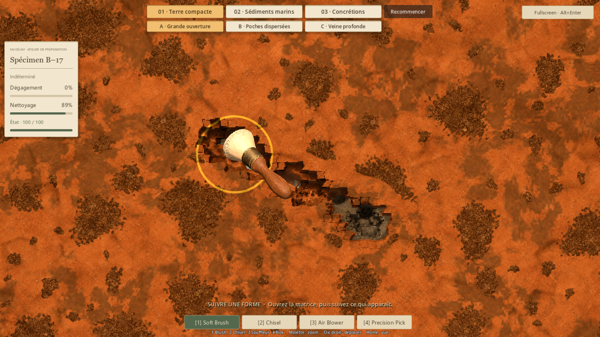
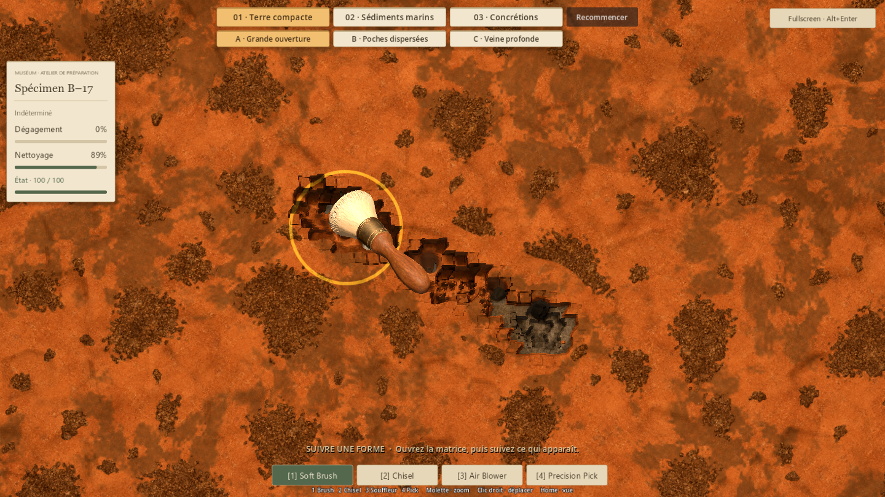
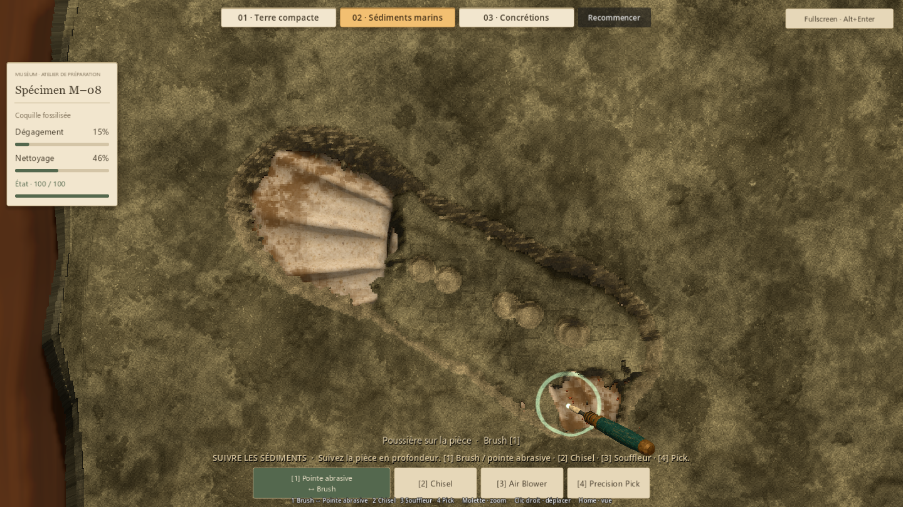
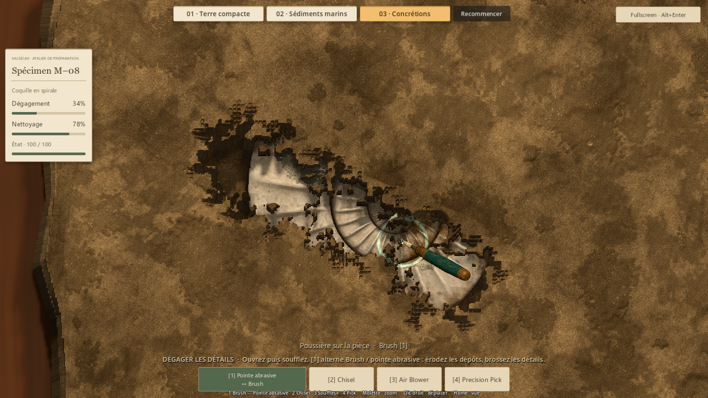
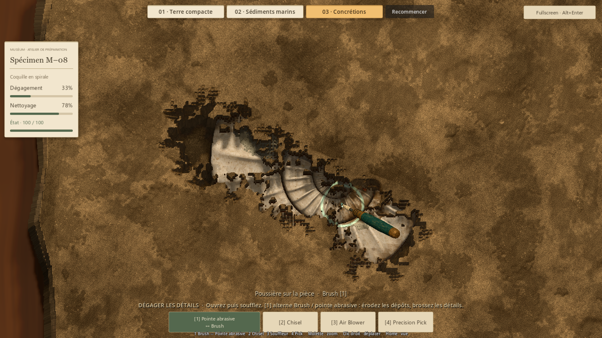

# Fluidité des outils — #43

## Résultat
Le contact visible du curseur et du modèle d'outil était actualisé par la physique
à 60 Hz. Le rendu pouvait afficher environ 240 images/s en répétant la même position
pendant plusieurs images. Le contrôleur recalcule maintenant le contact à chaque
image, après la caméra et avant les consommateurs visuels, sans interpolation ajoutée.

Les frappes et les outils continus restent simulés à 60 Hz. Rayons, puissances,
cadences, dégâts, film et volumes géologiques restent ceux de main a98fd46,
issu de la PR #42 fusionnée à la demande d'Antoine.

Le calcul des sédiments/concrétions évite aussi des recherches de propriétés et
allocations répétées dans la boucle, et rejette plus tôt les cellules qui ne peuvent
plus perdre de matière. Un instantané explicite conserve l'éligibilité des voisins
sur tout le geste : aucune propagation accélérée à travers une couverture intacte.

## Mesure du suivi visuel
Godot 4.7.2 stable, rendu Compatibility, RTX 5080, fenêtre native 1440 × 810,
plafond 240 FPS et physique 60 Hz. L'écran courant est annoncé à **279,96 Hz**
par DisplayServer ; VSync est activé (valeur 1). Aucun réglage Windows, écran,
VSync ou accumulation des entrées n'a été modifié.

| Préparation | Contact avant | Contact après | Images/s après | Images avec contact inchangé avant → après |
|---|---:|---:|---:|---:|
| Terre compacte A | 60.6/s | 240.3/s | 240.3 | 74.8 % → 0.0 % |
| Sédiments marins | 60.6/s | 240.6/s | 240.6 | 74.8 % → 0.0 % |
| Concrétions | 60.6/s | 240.5/s | 240.5 | 74.8 % → 0.0 % |

Le signal de test envoie une position de pointeur avant le traitement visuel de
chaque image, puis observe le contact après le rendu. Avant correction, environ
75 % des images de survol répètent la position précédente. Après, les 17 séquences
(survol, Chisel, Blower, Pick, Brush, plus abrasive sur les deux préparations
concernées) présentent toutes la dernière position reçue. L'écart logiciel observé
entre position envoyée et contact présenté devient nul sur ces séquences.

Cela démontre la suppression du palier de présentation à 60 Hz. Ce protocole
n'inclut pas l'électronique de la souris, le compositeur Windows, le scanout ou
l'écran : **il ne mesure pas une latence physique de zéro milliseconde**.
La pose effective du modèle est également contrôlée par projection vers le pointeur.

## Régularité en action et limites

| Préparation | Édition au souffle P95 avant → après | Intervalle de rendu P95 avant → après |
|---|---:|---:|
| Terre compacte A | 8.08 → 7.71 ms | 9.70 → 9.37 ms |
| Sédiments marins | 9.12 → 8.48 ms | 17.01 → 16.34 ms |
| Concrétions | 5.85 → 5.46 ms | 12.88 → 12.38 ms |

Les gains de calcul sont modestes. Terre compacte conserve son calcul de poche ;
la variation mesurée sur cette préparation n'est donc pas attribuée à l'optimisation
du noyau marin. Les mesures restent un couple de parcours de quelques secondes,
sensible au système et à l'échantillonnage des entrées. Le CSV conserve chaque phase,
y compris celles dont le P95 ne baisse pas.

Le souffle marin reste plus coûteux : environ 148 images/s en moyenne pendant
cette séquence après correction, contre 139 avant. Le suivi suit désormais chaque
image effectivement rendue, mais des pics CPU subsistent pendant les gestes denses.
Cette passe ne revendique ni 240 FPS constants en excavation ni l'élimination de
toutes les saccades. L'essai humain décidera si le défaut principal de suivi est résolu.

## Préservation du feeling
Un parcours distinct rejoue les mêmes entrées aux mêmes ticks de simulation sur
chaque préparation, en intercalant trois rafraîchissements visuels supplémentaires.
Après chacune des 14 séquences d'outils, les empreintes des hauteurs, plafonds,
expositions, film, fracture et résidus sont identiques au témoin. Dépôts adhérents,
condition, protections, nombre de débris, volume retiré et nombre d'impacts concordent
également. Les captures à cadence réelle servent à la revue visuelle ; leur état
final n'est pas utilisé pour affirmer une égalité de gameplay, car l'échantillonnage
par temps réel diffère naturellement entre deux exécutions.

La revue a conservé la copie explicite des hauteurs : les tableaux compacts Godot
partagent leurs données lors d'une affectation. La variante sans copie échouait à
l'équivalence et a été corrigée avant les mesures finales. La comparaison de rapports
normalise uniquement les types numériques JSON ; les empreintes binaires restent exactes.

## Revue visuelle
Même art et mêmes modèles. Les captures montrent le point de travail et le résultat
des séquences mesurées, pas une nouvelle composition artistique.

| Préparation | Avant | Après |
|---|---|---|
| Terre compacte |  |  |
| Marine |  |  |
| Concrétions |  |  |

## Vérifications
**692 contrôles fonctionnels et 284 contrôles de ressources, aucun échec.**

La synthèse finale et le détail des contrôles sont consignés dans
[summary.json](evidence/issue43/summary.json). Les suites couvrent le suivi à chaque
image, l'absence d'édition lors de la présentation, l'équivalence avec le témoin,
le focus, les panneaux, la sortie de fenêtre, l'archivage, le zoom/pan et les resets.
Les parcours natifs marine et concrétions couvrent aussi la couverture intacte sans
indice caché et la finition intégrale avec condition préservée.

## Essai humain
Relancer **Launch-Preparation-Demos.cmd**. Sur chaque préparation : déplacer un outil
rapidement puis lentement sans cliquer, travailler au Chisel/Pick, balayer avec
Brush/Blower et essayer la pointe abrasive là où elle est disponible. Tester aussi
le zoom et le passage fenêtre/plein écran avec Alt+Entrée.

Évaluer séparément le suivi du modèle sous la souris et les éventuels à-coups au
contact de matière. Si un ralentissement reste perceptible, préciser préparation,
outil et situation (dégagement massif, proximité du fossile ou finition).

## Reproduction et preuves
- Témoin runtime : main a98fd46. Le test natif a été ajouté avant toute correction.
- tests/run_issue43_fluidity_native.gd : boucle native à cadence réelle ; --label=before
  pour le témoin, --label=after pour les assertions de suivi. Ne pas lancer une autre
  suite simultanément pendant une mesure de performance.
- tests/run_issue43_fluidity_replay.gd : simulation déterministe, --headless ;
  --label=after compare les 14 états à la preuve before-replay.json versionnée.
- Arguments après le séparateur Godot : --qa et
  --distinction-store=res://work/issue43/badges.json. Sorties : work/issue43.
- [Avant](evidence/issue43/before.json), [après](evidence/issue43/after.json),
  [comparaison CSV](evidence/issue43/comparison.csv),
  [rejeu après](evidence/issue43/after-replay.json).
- La terre compacte A est le parcours chronométré ; les trois dispositions A/B/C
  sont vérifiées par la régression logique #37.

La fréquence annoncée suit l'API officielle
[DisplayServer.screen_get_refresh_rate](https://docs.godotengine.org/en/stable/classes/class_displayserver.html#class-displayserver-method-screen-get-refresh-rate).
Une mesure sur un autre écran ou en plein écran peut différer ; ce rapport décrit
la configuration réellement testée.
