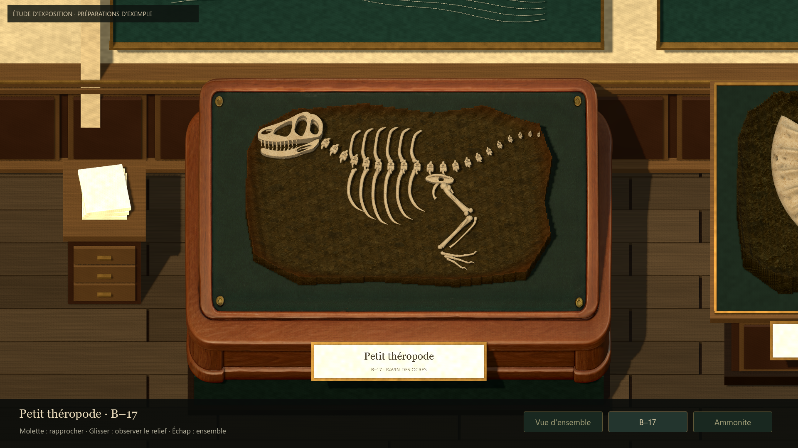
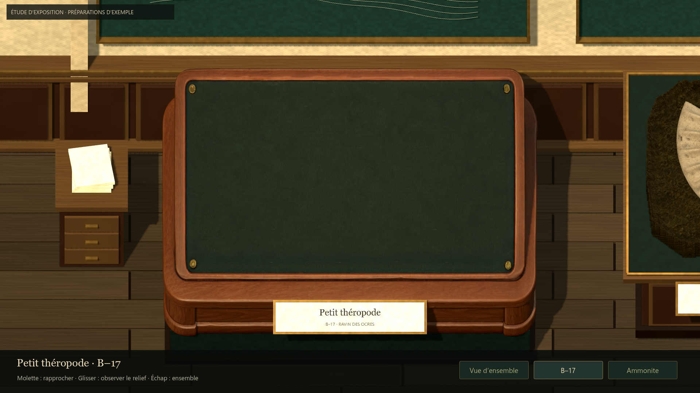
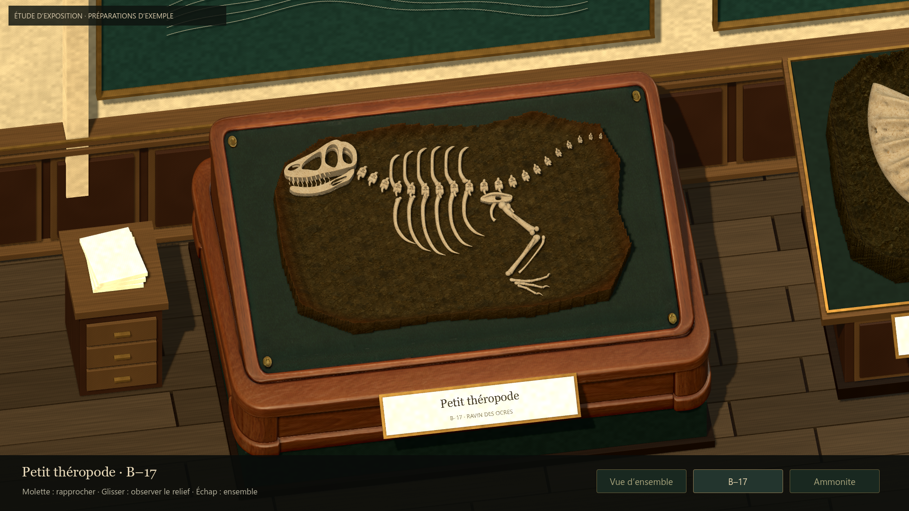
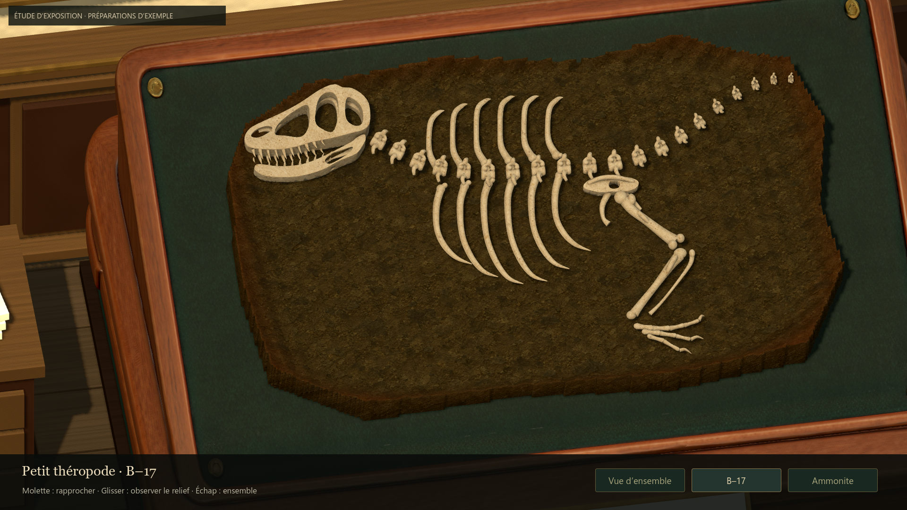
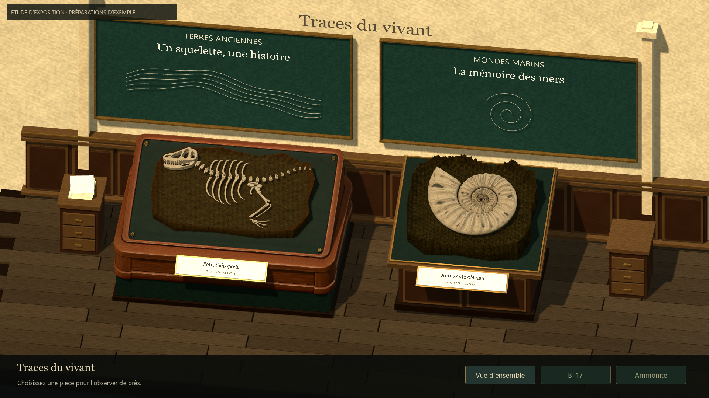

# Pilote Tripo B–17 dans Godot — #51

## Résultat
Le GLB fourni par Antoine remplace le présentoir procédural de B–17 dans l'essai
de galerie. Les arrondis, moulures, quatre fixations et fond vert proviennent
du modèle généré. Les matériaux gardent leurs textures PBR, avec une teinte
corrigée dans Godot pour calmer le bois orangé et un relief de normale adouci.

Le plateau a été mesuré sur sa géométrie réelle. Son échelle est adaptée par axe
au gabarit de galerie et au plan d'inclinaison existant ; le bloc est ajusté
uniformément à la zone libre pour laisser le cadre et les fixations visibles.
Le fossile, la matrice d'exemple et leurs matériaux ne sont pas retouchés.
Le socle inférieur et le cartel restent des éléments distincts.

## Source et traçabilité
- Original : assets/museum/source/tripo-studio/b17/museum_b17_stand_pilot.glb.
- Copie importable : assets/museum/models/b17_stand.glb, identique par SHA-256.
- 84 656 triangles ; un maillage, un matériau, trois images embarquées.
- Couleur 4096 × 4096 ; textures couleur, normale et rugosité/métal présentes.
- Génération faite par Antoine dans Studio ; aucun nouveau crédit consommé
  par l'agent pour cette passe. Les paramètres Studio exacts ne sont pas tous
  prouvés par le fichier.
- Import Godot avec tangentes, maillages d'ombre et LOD automatiques. Aucun
  remplacement de l'original par une version décimée.

## Revue et ajustements
Le modèle a été examiné de face et de dos en lumière neutre, puis dans la galerie.
La première insertion était trop orangée ; la deuxième correction de teinte
se rapproche davantage du noyer et laisse l'ivoire du fossile dominer.
Les vues d'ensemble, plateau vide, inspection, angle et détail ont été revues.
Le cadre est continu dans les vues proposées ; le bloc reste dans le lit vert
et son bord inférieur ne paraît ni enfoncé dans le support ni largement suspendu.

La référence d'objet et les modèles de préparation ont servi à la comparaison.
Cette passe n'effectue pas encore une nouvelle comparaison atelier/musée avec
deux captures à taille identique : elle conserve les ressources du fossile et
juge l'intégration du meuble dans la galerie.

## Limites concrètes
- Tripo a inventé une inscription en laiton au dos, absente de la référence.
  Elle n'apparaît pas dans les angles de galerie proposés. La supprimer par
  retouche avant de considérer cet asset comme une source de production finie.
- Le plateau a subi une adaptation d'échelle par axe : vérifier ses proportions
  à la revue humaine avant de figer le gabarit des autres meubles.
- L'architecture, les autres meubles et les matrices restent ceux de l'étude
  précédente ; ce pilote ne démontre pas la salle finale du concept.
- Les préparations sont toujours des exemples déterministes, pas des sauvegardes
  réelles du joueur. Le gameplay de préparation n'est pas modifié.
- Le résultat est soumis à la revue humaine ; aucune acceptation artistique ni
  fusion de PR ne se déduit des contrôles techniques.

## Vérifications
Godot 4.7.2 stable, Compatibility, fenêtre 1440 × 810, rendu 1920 × 1080.
31 contrôles natifs : commandes et navigation, bornes de zoom/angle, formats
4:3 / 21:9, intégrité des trois fichiers de sauvegarde, présence des textures,
taille du bloc dans le plateau et conservation byte pour byte du GLB source.
Résultats détaillés : [summary.json](evidence/issue51-b17/summary.json).

Les échantillons statiques restent proches du plafond de fréquence d'images ;
ils ne constituent pas une mesure de marge GPU ni une réponse aux particules #50.
Pas de nouvelle génération 3D, de modification de sauvegarde ou de logique d'outil.

## Captures natives

Défaut source à retoucher : [vue du dos](evidence/issue51-b17/source-back.png).

## Reproduire
- Essai interactif : Launch-Exhibition-Study.cmd, puis sélectionner B–17.
- Contrôles : Godot --path . --script res://tests/run_issue51_gallery_native.gd.
- Captures : Godot --path . --script res://tools/museum/capture_b17_pilot.gd.
  Exécuter avec rendu graphique ; sorties temporaires dans work/issue51-b17.

## Retour humain et continuation
Antoine apprécie le rendu du meuble B–17 et autorise la poursuite de la scène.
Le cartel frontal est rejeté. Ce retour ne valide ni la salle entière ni une
fusion. La passe suivante est documentée dans [Mobilier et travée](ISSUE51_MUSEUM_FURNITURE.md).
