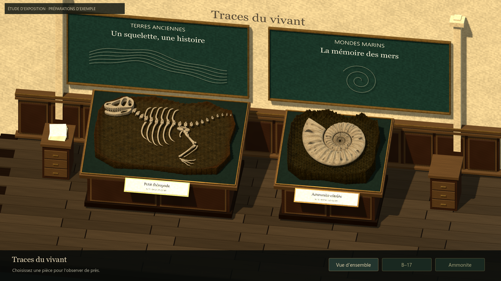
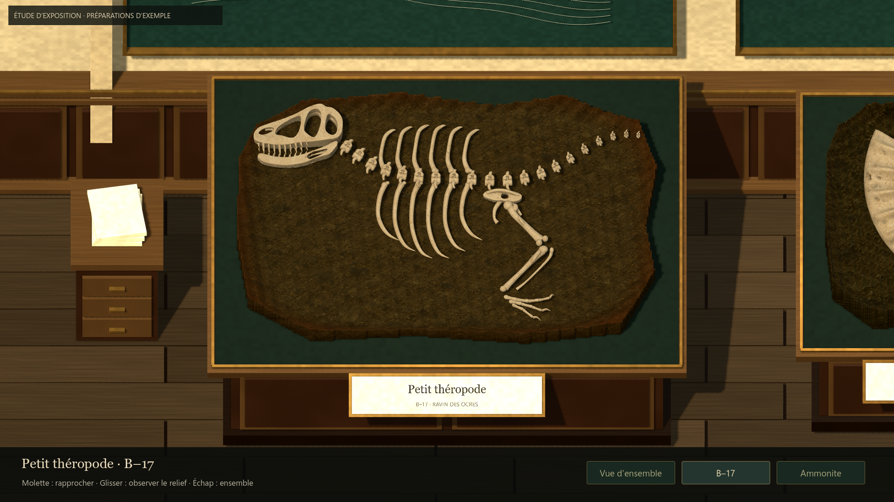
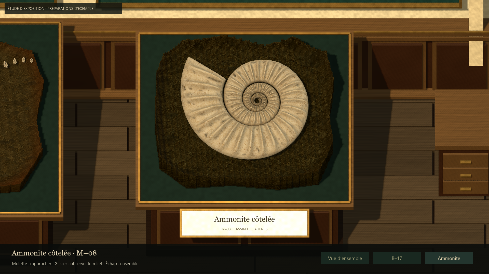
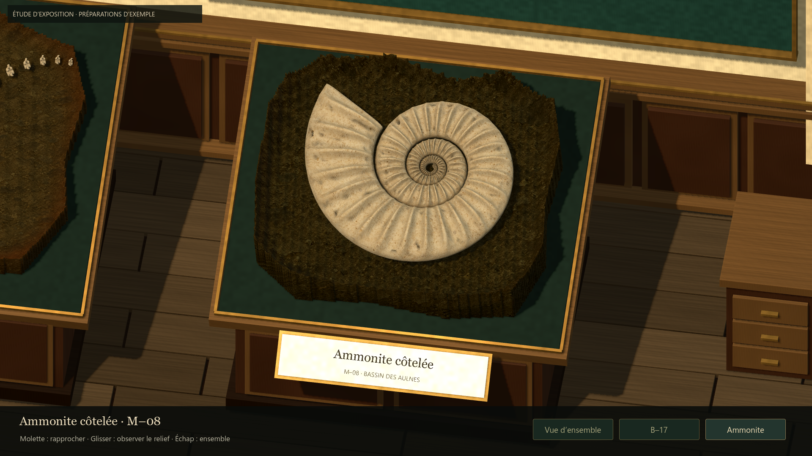

# Premier essai d'exposition — #51

## Résultat
Une alcôve 3D présente B–17 et M–08 dans deux matrices d'exemple, sur des
présentoirs inclinés. Boiseries, fonds vert sombre, cartels et lumière chaude
cherchent une continuité avec l'atelier. Les modèles de fossiles et la texture
d'ivoire sont ceux du jeu.

La vue d'ensemble se parcourt horizontalement. Un clic sur une pièce ou son
bouton ouvre une inspection rapprochée ; molette pour zoomer, glisser pour
faire varier légèrement l'angle, flèches pour changer de pièce, Échap pour
revenir à l'ensemble. Les transitions de cadrage sont progressives.

## Portée réelle
Cette scène sert à juger la présentation muséale. Les matrices sont des
exemples construits pour l'étude, à partir des modèles et champs de fossiles.
Elles ne sont ni des archives de parties réelles, ni une preuve de sauvegarde
fidèle du travail du joueur. Le bandeau « préparations d'exemple » le précise.

Le lanceur et la scène sont séparés. Aucun script/scène du gameplay existant
n'est modifié. Aucun contrôleur de fouille, effet de particules ou collection
active n'est instancié dans la galerie. Les données réelles ne sont pas écrites.
Les deux exemples sont entièrement découverts ; il ne s'agit pas d'une preuve
de masquage d'un fossile partiellement enterré.

La conservation 3D réelle, le raccordement des trois préparations et les arrivages
restent des étapes distinctes de #28 / #45. Les vues sont limitées, sans inspection
libre à 360°. Les polices utilisent Georgia / Segoe UI sur le PC Windows de référence
avec repli système ; le packaging multiplateforme n'est pas traité dans cet essai.

## Revue et corrections
Les captures natives ont conduit à diminuer la lumière, ajuster l'étendue de la
matrice autour des pièces, corriger le placement des boutons et la transition
d'angle, affiner les contours de la matrice, puis corriger l'orientation de ses
faces latérales et les biais d'ombre. Les cartels restent lisibles à l'inspection.
Le rendu est un premier échantillon artistique à évaluer humainement.

## Vérifications
- Godot 4.7.2 stable, Compatibility, fenêtre 1440 × 810, rendu interne 1920 × 1080.
- 26 contrôles natifs réussis : sélection au clic, navigation clavier et boutons,
  bornes de zoom/angle, perte de focus, visibilité des commandes en 4:3 et 21:9.
- Empreintes des trois emplacements de sauvegarde vérifiées avant/après, inchangées.
- 290 chargements de ressources du dépôt réussis, sans erreur.
- Sur trois courts échantillons de galerie : temps moyen d'image environ 4,12 ms ;
  P95 entre 4,18 et 4,22 ms sur la machine de référence. Mesure de scène statique,
  distincte de la préparation et des baisses de FPS de #50.

Détails : [summary.json](evidence/issue51/summary.json).
Test : tests/run_issue51_gallery_native.gd. Sorties temporaires : work/issue51.
Le retour humain ci-dessous complète ces vérifications techniques.

## Captures

## Essai proposé
Double-cliquer Launch-Exhibition-Study.cmd dans le worktree preparation-demos.
Observer l'ensemble, ouvrir B–17, rapprocher le crâne, passer à l'ammonite,
faire légèrement varier l'angle, puis revenir à l'ensemble.

Évaluer : envie d'admirer/conserver ces objets, cohérence du lieu avec l'atelier,
lisibilité des reliefs et confort de navigation. Cet essai n'évalue pas encore
la satisfaction d'une vraie acquisition ni la répétition de toute la boucle.

## Retour humain du 17 octobre et recherche artistique
Antoine apprécie la caméra et les transitions entre les pièces. Il aimerait
voir ses vraies préparations dans cette présentation. Le décor actuel est
jugé insuffisant pour la production : architecture, environnement et ambiance
doivent être conçus avec de vraies références puis une pipeline d'assets Tripo.

Deux concepts Imagegen ont été produits et revus : une première composition
trop réaliste selon la revue de travail, puis une variante plus stylisée.
Ils sont documentés dans [l'étude artistique](../design/MUSEUM_ART_DIRECTION_STUDY.md).
Ce sont des propositions, distinctes des captures natives ci-dessus.
Aucune modification de runtime ni génération Tripo dans cette passe de cadrage.

## Choix de référence artistique
Antoine choisit ensuite le second concept stylisé, à condition que les graphismes
restent cohérents avec les préparations. L'étude artistique précise maintenant
la hiérarchie des références et la comparaison atelier/musée à effectuer.
La réalisation native et le rendu des matrices réelles restent à éprouver.
Cette mise à jour est documentaire ; aucun runtime modifié ni nouveau test de jeu.

## Références du mobilier et préparation Tripo

Quatre images isolées produites avec Imagegen intégré et revues : présentoir long,
présentoir compact, vitrine vide sans verre et applique éteinte. Elles reprennent
le second concept et la matière tactile de la préparation. Les PNG, prompts,
empreintes et contrôles de transparence sont conservés dans
[le dossier mobilier](../visual-references/museum/furniture/README.md).

La simulation CLI du présentoir B–17 est valide : une génération image-to-model,
H3.1, 10 000 faces, smart low-poly, textures PBR détaillées ; aucun appel de génération
exécuté. Le guide inclut une alternative dans Studio et distingue ses crédits de
ceux de l'API. Aucun nouveau modèle 3D ni changement de runtime ; vérifications
limitées à la revue d'images, aux fichiers, au plan et à git diff --check.

## Pilote mobilier Tripo intégré
Le présentoir B–17 fourni par Antoine est désormais importé dans la galerie,
avec adaptation du plateau et correction de matériau. Contrôles étendus à 31,
captures de l'objet vide et avec le bloc, ainsi que vues de détail et d'angle.
Voir le [rapport du pilote B–17](ISSUE51_B17_TRIPO_PILOT.md) pour les preuves,
la limite de l'inscription inventée au dos et la portée exacte de cette passe.
