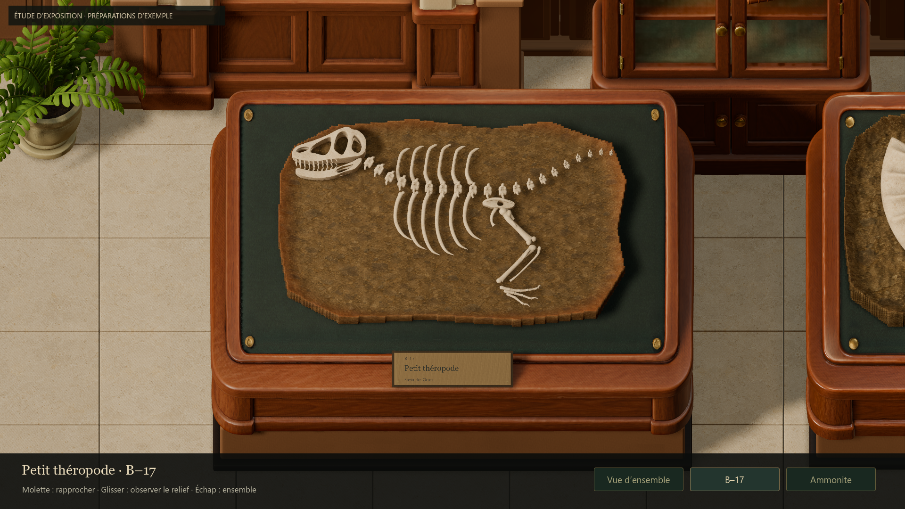
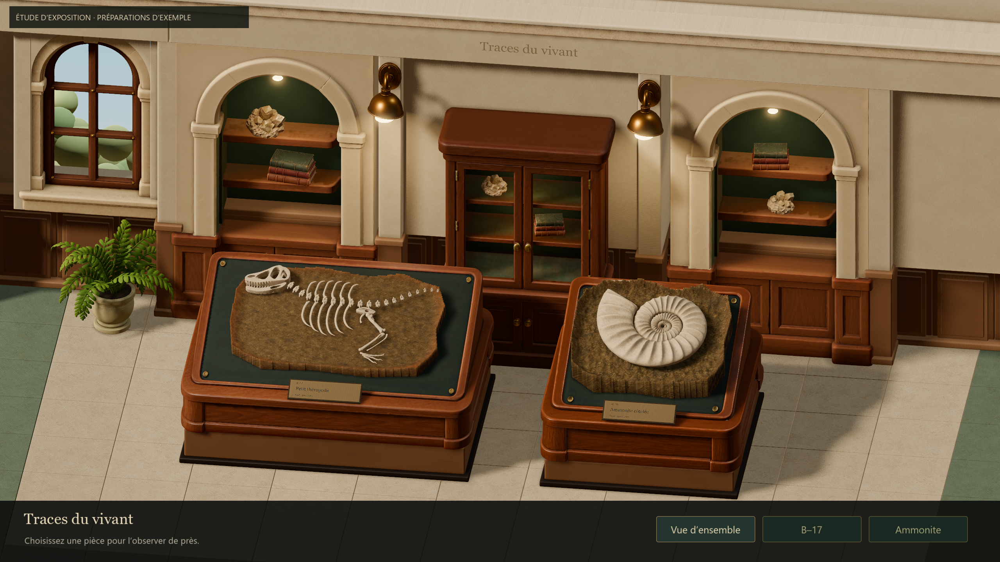
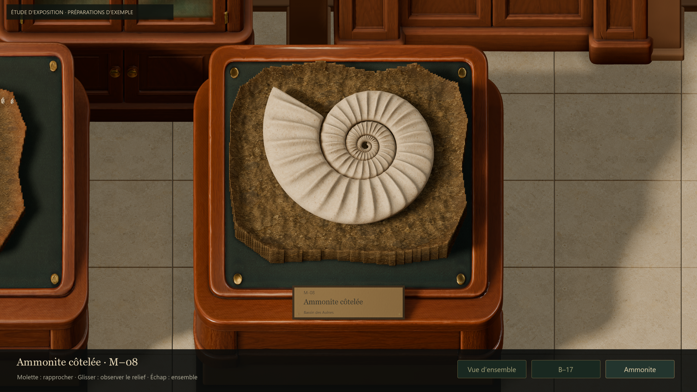

# Galerie — correction de la netteté

## Diagnostic et résultat
La comparaison native à cadrage identique confirme deux contributions :
- Le TAA atténuait les arêtes et les détails fins, notamment dents et côtes.
- Le mode de mise à l’échelle calculait toujours une image 1920 × 1080,
  ensuite étirée en plein écran 2560 × 1440 sur la machine d’Antoine.

La galerie emploie maintenant MSAA 4× sans TAA et le mode `canvas_items` :
la 3D utilise les pixels réels de la fenêtre, tandis que l’UI conserve ses
coordonnées logiques et le cadrage 16:9. Les autres formats gardent les bandes
existantes. Aucun filtre d’accentuation artificielle ni profondeur de champ
n’a été ajouté. Les réglages de fenêtre/MSAA/TAA antérieurs sont restaurés
quand la galerie quitte l’arbre.

Le filtrage de l’ombre directionnelle passe de moyen à élevé, celui des lampes
reste moyen. Cela réduit le grain rendu visible par l’abandon du TAA tout en
conservant les pénombres et l’ambiance de la base appréciée. Les couleurs,
lumières, modèles, textures et préparation ne sont pas retouchés.

## Comparaison et choix
Captures de la vue d’ensemble, des deux inspections, de l’angle oblique et du
fond relues à résolution native. Les dents, côtes et reliefs de l’ammonite sont
plus distincts. Le flou temporel a disparu ; un grain fin subsiste dans certaines
pénombres. Le petit texte des cartels reste limité par sa taille à distance.

Les essais avec des ombres plus étroites ou un filtrage PCF simple ont été
écartés : plus rapides, ils durcissaient trop les ombres. Le filtrage élevé de
toutes les lumières était aussi trop coûteux (environ 7,1 ms en vue générale
1440p). Le compromis retenu réserve ce filtrage à la lumière directionnelle.

Le comparatif 1080p ci-dessous isole le rendu à cadrage et résolution identiques.
Les captures finales 1440p montrent le résultat en pleine résolution ; ne pas
comparer leur netteté après réduction par l’afficheur Markdown.

## Vérification
- 95 contrôles natifs Forward+ et 95 Compatibility, zéro échec : navigation,
  souris/clavier, zoom, angles, perte de focus, sources PBR, données joueur,
  UI et résolution du contenu aux formats 4:3, 21:9 et 2560 × 1440.
- Contrôle effectif des dimensions de l’image GPU lue, et de la restauration
  des réglages après retrait de la galerie.
- 300 ressources chargées, zéro échec. Logs finaux sans erreur de script/shader.
- Diff de `project.godot`, scripts de fouille/collection/préparations, assets,
  scènes et lanceurs de préparation vide par rapport à e79e761.
- Le premier test de résolution attendait à tort les dimensions de la fenêtre
  dans les bandes 4:3/21:9 : il vérifie maintenant les pixels de la zone de
  contenu. L’attente de `tree_exited` rend le contrôle de restauration explicite.

### Coût mesuré
Godot 4.7.2, Forward+, RTX 5080. 90 images de chauffe, 240 images de mesure
par vue fixe, plafond et VSync désactivés pour mesurer le coût. Temps en ms :

| Résolution native | Vue | Moyenne | P95 |
|---|---|---:|---:|
| 1920 × 1080 | Ensemble | 4,20 | 4,46 |
| 1920 × 1080 | B–17 | 3,90 | 4,09 |
| 1920 × 1080 | M–08 | 3,70 | 3,88 |
| 2560 × 1440 | Ensemble | 6,28 | 6,61 |
| 2560 × 1440 | B–17 | 5,96 | 6,27 |
| 2560 × 1440 | M–08 | 5,85 | 6,17 |

**Le plein écran natif ne tient pas 240 FPS dans cette galerie** : ces vues
1440p correspondent à environ 159–171 FPS moyens. L’ancien candidat calculait
seulement 1080p (3,35–3,87 ms moyens), même en plein écran. Ce correctif privilégie
la netteté et conserve les ombres appréciées ; il ne prétend pas être une
optimisation de la galerie. Le 1080p reste proche du budget, avec un dépassement
en vue d’ensemble. Le renderer et les performances des préparations ne changent
pas. Une future optimisation de la salle pourra traiter l’éclairage statique
et les maillages, sans réintroduire une résolution réduite silencieusement.

## Reproduire
`tools/museum/capture_gallery_lookdev.gd` en Forward+, puis arguments utilisateur :
`--out=work/issue51-clarity/review --size=2560x1440`.
`--previous-rendering` rétablit dans l’outil de capture uniquement le couple
viewport fixe/TAA et les filtres d’ombres moyens pour comparaison.
Le lanceur jouable reste `Launch-Exhibition-Study.cmd`.

La mesure des dimensions emploie `get_texture().get_image().get_size()` : sur
cette version, `ViewportTexture.get_size()` annonce une taille différente avec
le mode canvas_items, alors que le readback confirme les pixels réels.

Références techniques : [modes de résolution Godot](https://docs.godotengine.org/en/4.7/classes/class_window.html#class-window-property-content-scale-mode),
[antialiasing Godot](https://docs.godotengine.org/en/4.7/tutorials/3d/3d_antialiasing.html).

## Preuves
- [Contrôles Forward+](evidence/issue51-clarity/native-forward.json)
- [Contrôles Compatibility](evidence/issue51-clarity/native-compatibility.json)
- [Ressources](evidence/issue51-clarity/resources.json)
- [Mesures 1080p](evidence/issue51-clarity/metrics-1080.json)
- [Mesures 1440p](evidence/issue51-clarity/metrics-1440.json)

### Même résolution : avant, puis après

### Résultat natif 1440p

