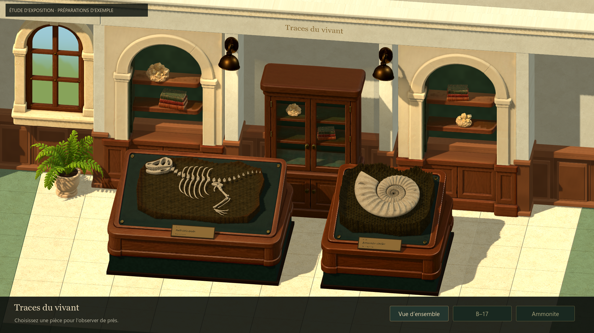
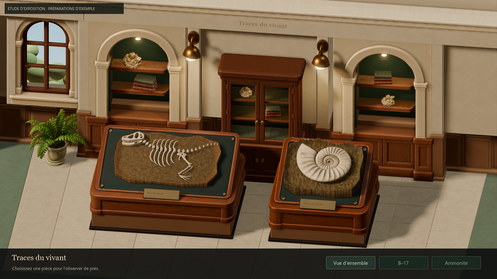
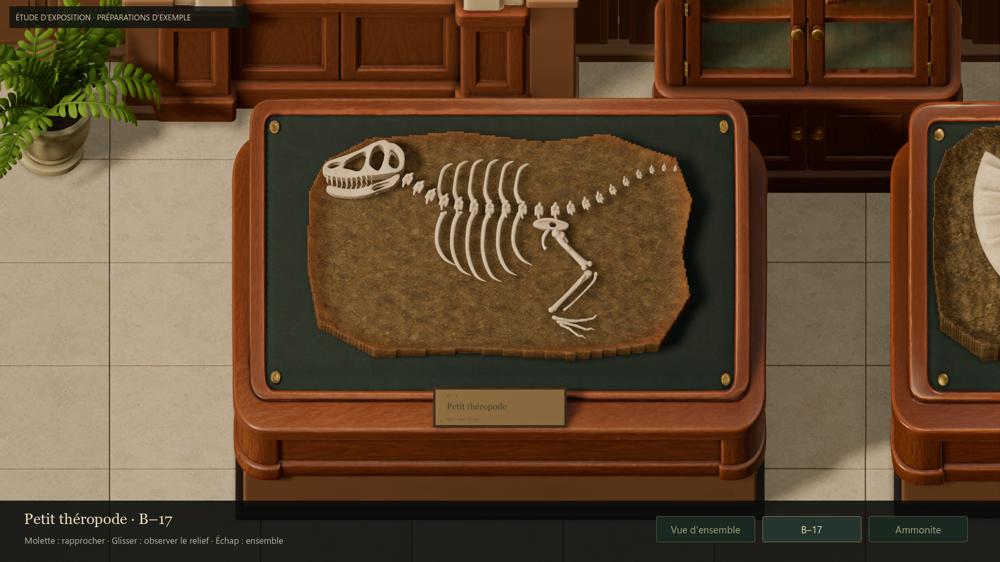
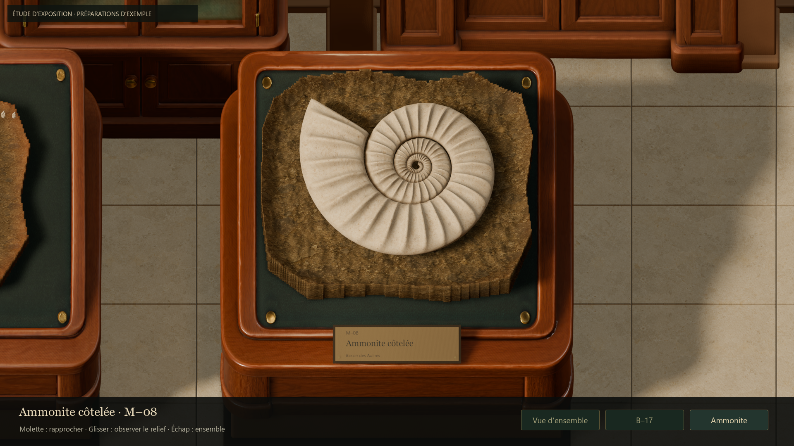
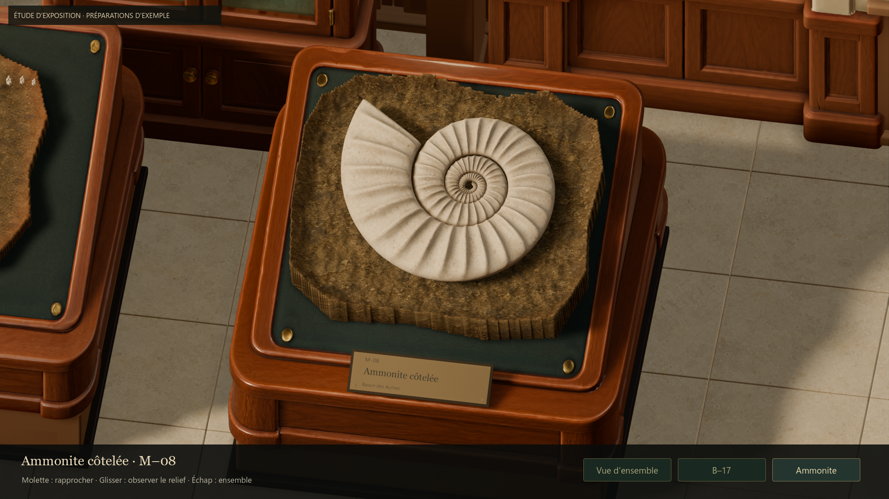
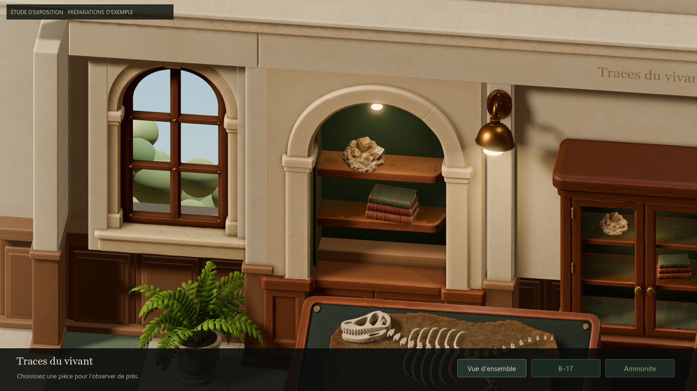
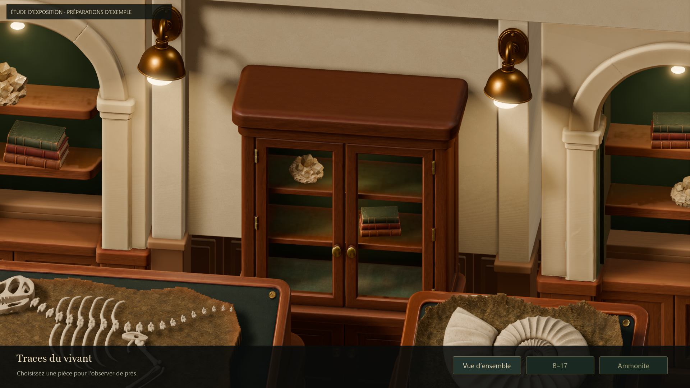

# Galerie — passe de rendu et comparaison artistique

> Revue suivante : Antoine apprécie cette base, mais signale un flou près/loin.
> Le [correctif de netteté](ISSUE51_GALLERY_CLARITY.md) remplace le réglage TAA
> et la résolution fixe décrits dans ce rapport. Les mesures ci-dessous décrivent
> le candidat précédent.

## Intention et résultat
Antoine demande de compléter le rendu Godot, de comparer à la référence
stylisée et d'itérer sur lumière, matières et finitions. La direction reste
celle de MUSEUM_ART_DIRECTION_STUDY.md : crème, noyer, vert bouteille, ivoire
chaud, avec les préparations comme sujets principaux.

Le candidat emploie Forward+ pour les ombres douces, une occlusion de contact,
une contribution indirecte SSIL légère, un probe de réflexion et un traitement
AgX. Les appliques ont une source émissive visible ; niches et vitrine reçoivent
des touches de lumière chaude. Le plein jour reste plus neutre que les lampes.

Les matériaux importés conservent leurs cartes PBR 4K. Les teintes, normales et
réponses spéculaires sont harmonisées dans des copies locales de matériaux.
Calcaire et enduit ajoutent une microvariation de normale et de rugosité issue
de leurs textures, avec protection contre les gradients dégénérés. Cela reste
un relief de shader, pas un nouveau jeu de textures PBR d'auteur.

Les panneaux entre niches sont rapprochés du plan des meubles pour éviter les
grands retraits sombres. Les socles ont un soubassement boisé aux arêtes adoucies.
La fenêtre possède une ouverture, des retours de maçonnerie, un vitrage léger
et un petit jardin 3D déterministe derrière elle. L'éclairage du jardin est
limité à ses propres objets.

La nouvelle lumière révélait les vagues périodiques de l'ancienne matrice
d'exemple. Sa surface et sa variation de couleur utilisent maintenant un bruit
déterministe. Les modèles de fossiles, leur shader et les champs de préparation
restent ceux du jeu ; seule la matrice d'exposition est retouchée.

## Revue par rapport à la référence
Référence : [galerie stylisée](../visual-references/museum/02-gallery-stylized.png).

- **Lumière et matières :** ombres moins découpées, contacts plus lisibles,
  lampes allumées, bois satiné et pierre mate. Le laiton reçoit des reflets de
  l'environnement ; le fond des niches garde de la profondeur.
- **Hiérarchie :** les préparations restent au premier plan. L'ivoire et les
  sillons de M–08 restent visibles en inspection. Les lumières du fond ne
  blanchissent pas les spécimens.
- **Assemblage :** les pans de mur relient maintenant les modules ; les grandes
  cavités noires entre les pilastres ont été réduites. Les retours de fenêtre
  ferment les fuites de ciel observées pendant la revue.
- **Itérations :** comparaison initiale des deux renderers, reprise d'une version
  trop sombre, suppression du grain des ombres, calibration des ampoules,
  correction du relief périodique, puis ajustements d'exposition et de raccords.
- **Coût :** le premier réglage de filtrage élevé dépassait le budget en vue
  générale. Le réglage retenu associe filtrage moyen, TAA et effets de contact à
  demi-résolution. Il conserve la douceur dans les captures à un coût inférieur.

L'évaluation de l'agent est positive sur la cohérence et la mise en valeur ;
la validation artistique du candidat appartient à Antoine. Le concept reste
une cible de composition et d'ambiance, pas une preuve de qualité native.

## Architecture technique
Launch-Exhibition-Study.cmd démarre la galerie dans un processus Forward+.
project.godot, les lanceurs de préparation et leur renderer Compatibility
sont inchangés. Une future boucle atelier/musée dans un seul processus devra
choisir un renderer commun et comparer l'atelier avant migration.

La lumière indirecte ajoutée est SSIL, donc dépendante des surfaces visibles à
l'écran, complétée par un remplissage contrôlé. Il n'y a pas de bake LightmapGI,
VoxelGI ou SDFGI dans cette passe. Le probe de réflexion est capturé une fois.
Le secours Compatibility désactive SSIL/TAA et emploie Filmic ; il ne fournit
pas les mêmes ombres que le rendu présenté par le lanceur.

## Vérifications
Godot 4.7.2 stable, RTX 5080, capture interne 1920 × 1080, fenêtre 1440 × 810.

- **85 contrôles natifs par renderer**, Forward+ et Compatibility, zéro échec :
  souris/clavier/boutons, zoom, angles, perte de focus, formats 4:3 et 21:9,
  sources GLB et cartes PBR conservées, position du décor et données joueur intactes.
- **300 ressources chargées**, zéro échec.
- Logs des captures examinés ; pas d'erreur de script, shader ou chargement.
- Diff des fichiers de préparation, assets sources, scènes et project.godot vide
  par rapport à afeedc9. Revue du diff et git diff --check.
- Vue générale, B–17, ammonite, angle oblique, fenêtre/niche et vitrine revus
  dans des captures natives sans retouche.

Mesure non plafonnée après stabilisation, 240 images par vue, VSync désactivée :

| Vue | Temps moyen | P95 | GPU moyen |
|---|---:|---:|---:|
| Vue d'ensemble | 3.87 ms | 4.08 ms | 3.52 ms |
| Inspection B–17 | 3.57 ms | 3.78 ms | 3.24 ms |
| Inspection M–08 | 3.35 ms | 3.54 ms | 3.01 ms |

Avant ajout des effets, la même scène exécutée en Forward+ prenait environ
1,13–1,27 ms/image. La nouvelle passe coûte davantage ; elle reste sous le
budget de 4,17 ms au P95 sur ces vues fixes de la machine de référence.
La marge en vue générale est limitée. Les contrôles avec plafond 240 FPS
mesurent environ 4,12 ms en moyenne ; l'ordonnancement peut dépasser 4,17 ms
sur certaines images. Ce n'est pas un benchmark de la fouille ni une garantie
pour d'autres cartes graphiques.

## Reproduire
- Lanceur jouable : Launch-Exhibition-Study.cmd.
- Contrôles : tests/run_issue51_gallery_native.gd, avec --rendering-method
  forward_plus ou gl_compatibility.
- Captures et mesures : tools/museum/capture_gallery_lookdev.gd, avec
  --rendering-method forward_plus puis -- --out=work/issue51-lookdev/review.
- Chargement global : tests/run_runtime_resources.gd, en mode headless.

## Limites de cet essai
Les deux préparations restent des exemples, sans sauvegarde réelle de fouille.
Le jardin est un décor secondaire stylisé simple ; la richesse de l'extérieur
et des accessoires du concept n'est pas entièrement reproduite. L'UI relève
toujours de #46. L'inscription au dos du présentoir B–17 et la comparaison
atelier/musée à taille strictement identique restent des sujets antérieurs.
Les exports Tripo détaillés sont conservés ; l'optimisation d'une grande
collection de meubles et l'éclairage précalculé ne sont pas traités ici.

## Preuves
- [Contrôles Forward+](evidence/issue51-lookdev/native-forward.json)
- [Contrôles Compatibility](evidence/issue51-lookdev/native-compatibility.json)
- [Ressources](evidence/issue51-lookdev/resources.json)
- [Mesures finales](evidence/issue51-lookdev/metrics.json)
- [Mesures initiales Forward+](evidence/issue51-lookdev/before-forward-metrics.json)

### Avant

### Candidat

