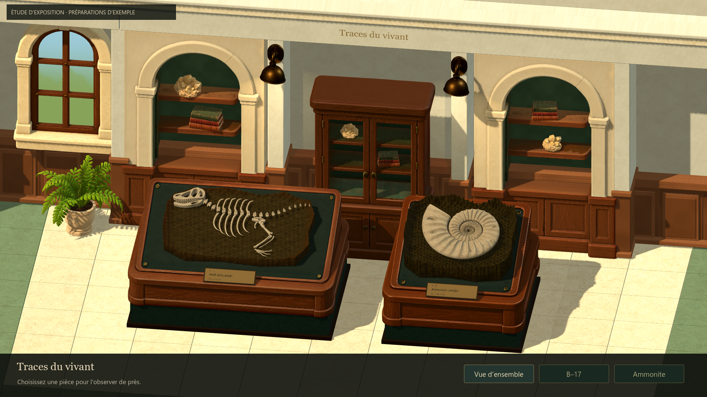
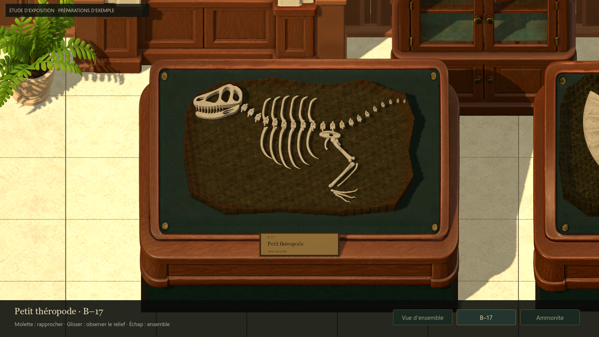
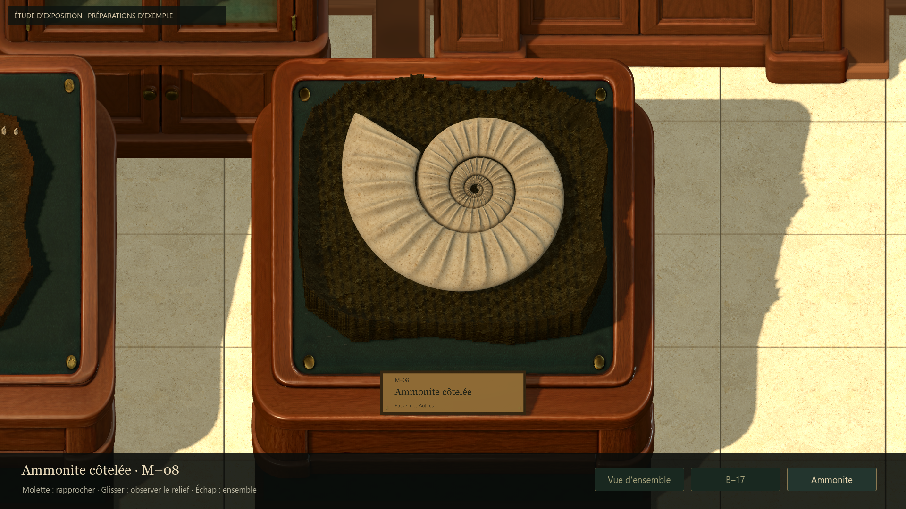
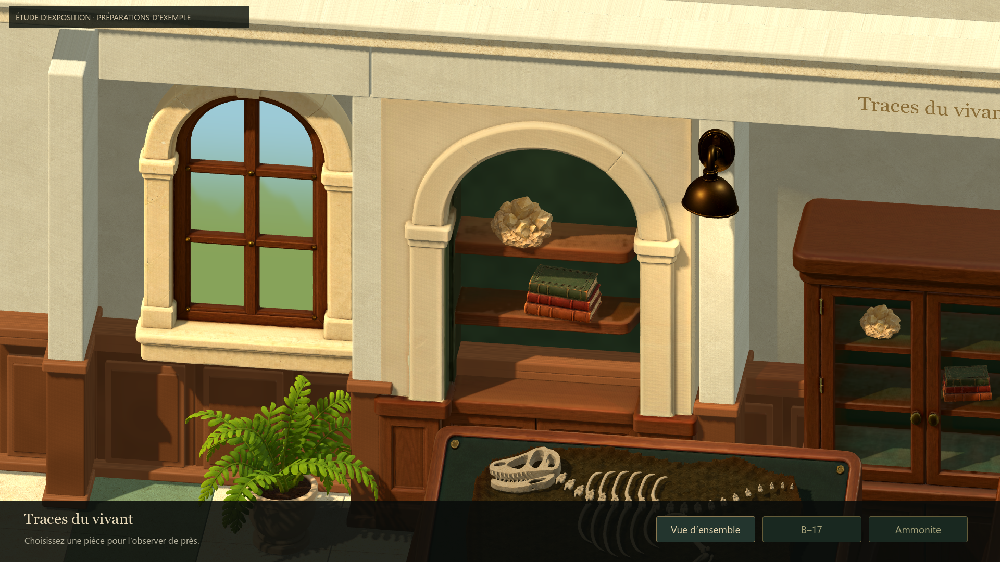
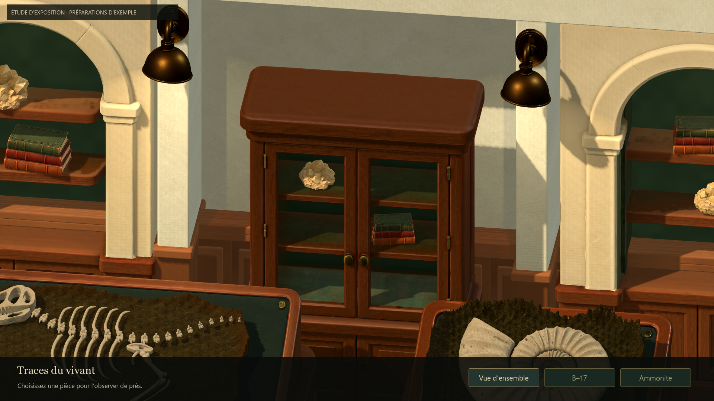
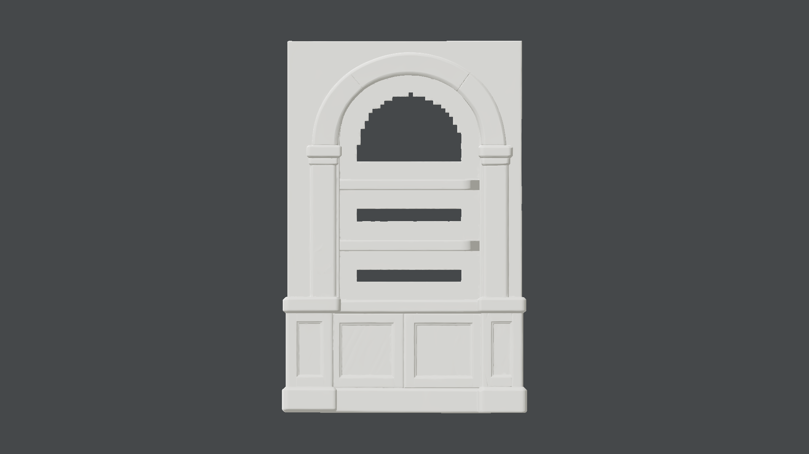

# Environnement du musée — intégration des cinq exports

## Résultat
La galerie emploie les cinq modèles fournis par Antoine, en plus des quatre
meubles précédents. Deux niches intégrées à la travée accueillent livres et
minéraux ; une fenêtre et une fougère habitent le côté gauche. La vitrine reçoit
quelques accessoires décoratifs. B–17 et M–08 restent les sujets principaux.

Le sol emploie des dalles de calcaire aux arêtes adoucies et joints fins. L'enduit
et la pierre utilisent les deux images du pack comme bases couleur, avec
échantillonnage miroir et mélange d'échelles pour limiter les raccords.
Ce ne sont pas des ensembles PBR générés complets. Les boiseries et profils
architecturaux sont dimensionnés dans Godot.

La vue d'ensemble est légèrement élargie et relevée pour intégrer la nouvelle
travée. Commandes, transitions, cadrages d'inspection et préparations conservés.
La lumière principale est moins intense, avec davantage de remplissage ; les
appliques gardent une contribution chaude locale.

## Sources et provenance
| Export reçu | Triangles | Copie runtime |
|---|---:|---|
| 01 niche.glb | 170 764 | wall_niche.glb |
| 02 fenetre.glb | 124 188 | arched_window.glb |
| 03 Fougère.glb | 197 026 | potted_fern.glb |
| 04 livres.glb | 83 360 | field_books.glb |
| 05 mineral.glb | 94 336 | mineral_sample.glb |

Chaque GLB contient un maillage, un matériau et trois textures intégrées 4K.
Les originaux sont conservés, avec empreinte et inspection du conteneur, dans
assets/museum/source/tripo-studio/{wall_niche,arched_window,potted_fern,field_books,mineral_sample}/.
Les copies runtime dans assets/museum/models/ sont identiques par SHA-256.
Les corrections de matériau, placement et géométrie complémentaire sont locales
à la scène ; aucune décimation ni modification des sources.

Les cinq fichiers déposés initialement dans docs/visual-references/museum/furniture/
ont été rangés dans le dépôt stable Documents/ArchaeologyGame-Assets/Tripo/museum/
après vérification des copies. Les textures extraites par Godot et leurs métadonnées
d'import font partie du dépôt. Les paramètres Studio exacts restent non attestés.
Aucun nouvel appel Tripo ni crédit dépensé par l'agent.

## Diagnostic de la niche
Les trois ouvertures persistent dans la capture sans textures. Le GLB utilise
une matière opaque et une base couleur RGB : il manque bien de la géométrie au
fond. Le cadre et les étagères restent exploitables.

Un dos vert continu est ajouté devant le plan défectueux, en retrait des
étagères. Il couvre toute la surface intérieure plutôt que de juxtaposer trois
rustines de couleur. Le GLB source reste défectueux s'il est ouvert seul :
la réparation appartient à l'assemblage de galerie, réutilisable dans Godot.
Les vues générale et oblique ont été examinées après correction.
La fenêtre possède bien ses six ouvertures ; aucun panneau opaque ne les bouche.

## Revue et itérations
- Inspection native isolée des cinq modèles, face et trois quarts ; niche sans
  textures pour distinguer trous et matériau.
- Correction des raccords entre niches, pans droits, soubassements et corniche.
- Déplacement des appliques sur la face des supports pour éviter leur occultation.
- Mesure des tablettes de la vitrine et correction des objets initialement
  suspendus devant elles ; alternance des accessoires dans les deux niches.
- Ajustement de l'échelle de fenêtre pour préserver sa silhouette dans la travée.
- Revue des captures ensemble, B–17, M–08, angle d'inspection et détails du décor.

## Vérifications
Godot 4.7.2 stable, Compatibility, RTX 5080, fenêtre 1440 × 810,
capture interne 1920 × 1080.
- **85 contrôles natifs réussis** : navigation, zoom, angles, formats 4:3 / 21:9,
  sauvegardes intactes, cinq nouvelles sources et textures 4K conservées,
  dos de niche continu et décor dégagé des préparations.
- **298 ressources chargées**, zéro échec.
- Échantillons statiques : moyenne 4,12 ms, P95 4,215–4,217 ms. Le plafond de
  cadence limite l'interprétation ; ce n'est ni une mesure de marge GPU ni un
  benchmark des particules de fouille.
- Aucun script, asset ou réglage de préparation modifié.
- Vérification du diff et des empreintes avant livraison.

Reproduction : tests/run_issue51_gallery_native.gd,
tests/run_runtime_resources.gd, tools/museum/inspect_environment.gd et
tools/museum/capture_gallery_environment.gd.
[Résultats natifs](evidence/issue51-environment/summary.json).

## Limites à garder visibles
La galerie reste un essai à soumettre à Antoine. Le jardin derrière la fenêtre
est une évocation graphique simple, sans vraie scène extérieure ni vitrage.
Quelques variations de teinte entre modules et pans droits et la douceur des
ombres peuvent encore être raffinées. Les sources détaillées avec textures 4K
ne constituent pas le budget définitif d'une galerie agrandie.
L'inscription inventée au dos de B–17 reste un travail antérieur en attente.
Les spécimens sont toujours des exemples déterministes, pas la sauvegarde réelle
d'une préparation. Aucune régénération n'a semblé nécessaire pour présenter cet
assemblage, mais ce jugement ne remplace pas la validation artistique humaine.

## Captures

