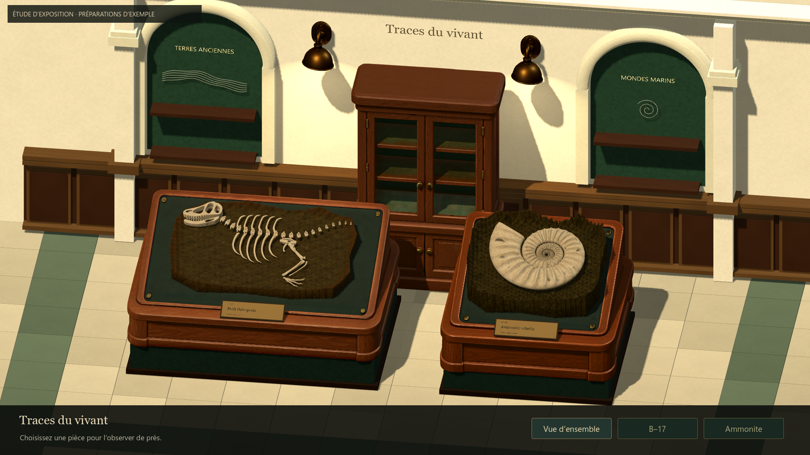
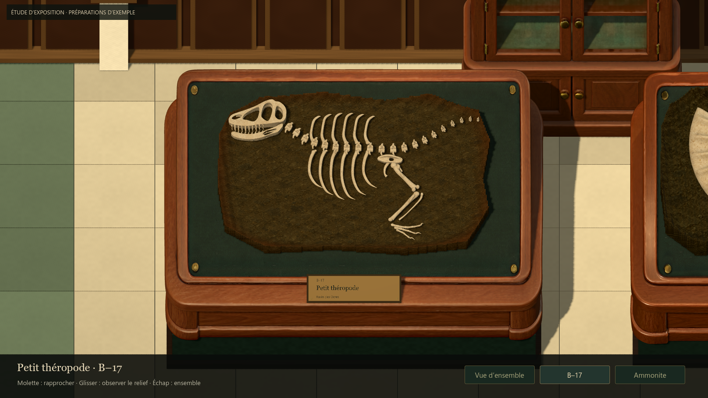
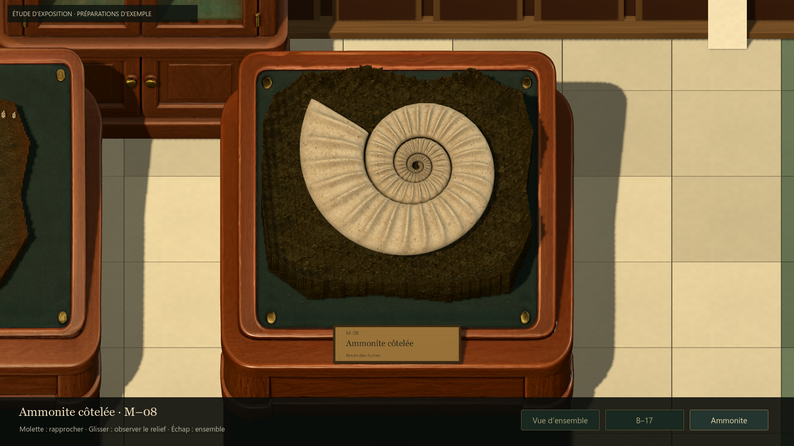
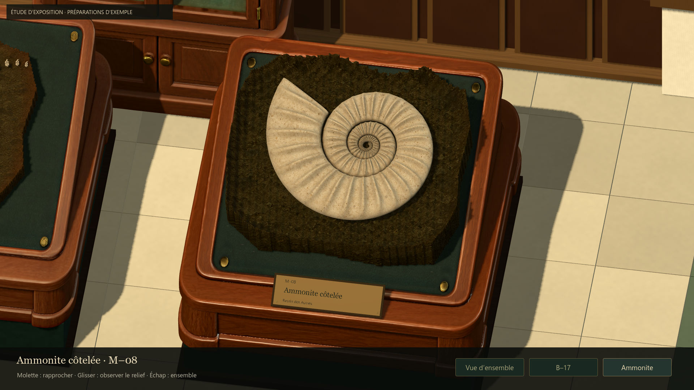

# Mobilier Tripo et travée de musée — #51

## Résultat
Les quatre références de mobilier ont maintenant une incarnation native dans
Godot : présentoir B–17, présentoir M–08, vitrine et deux instances de l’applique.
Le bois est harmonisé autour du rendu B–17 apprécié par Antoine. Les textures
PBR 4K sont conservées ; aucun original n’est décimé ou écrasé.

Les grandes étiquettes claires sont remplacées par de petits cartels en métal
patiné, posés sur les rebords. Le nom reste lisible à l’inspection ; la vue
d’ensemble privilégie les spécimens plutôt que les textes.

La travée comporte désormais un sol minéral à bordure verte, des niches cintrées,
des boiseries et une vitrine centrale. Les appliques produisent une lumière
locale chaude. La vue générale est légèrement redressée pour inclure les
niches ; les commandes, transitions et cadrages d’inspection sont conservés.

## Sources reçues le 17 octobre 2026
| Export Studio d’Antoine | Triangles source | Copie runtime |
|---|---:|---|
| Presentoir 02.glb | 84 089 | assets/museum/models/ammonite_stand.glb |
| 03 vitrine.glb | 163 290 | assets/museum/models/cabinet.glb |
| 04 lampe laiton.glb | 99 128 | assets/museum/models/wall_lamp.glb |

Les originaux et leurs empreintes sont archivés dans
assets/museum/source/tripo-studio/{ammonite,cabinet,wall-lamp}/.
Chaque export contient un maillage, un matériau et trois images intégrées,
sans dépendance externe. Les copies runtime sont identiques par SHA-256.
Les réglages du guide sont des recommandations ; les paramètres exacts de
génération ne sont pas tous attestés par les fichiers reçus.

La vitrine a été examinée de face et de dos : ses ouvertures sont bien ouvertes,
sans surface opaque à la place du verre. L’applique a été examinée par-dessous :
elle comporte un réflecteur creux et une ampoule. L’intérieur n’est pas aussi
régulièrement ivoire que dans la référence ; il reste une retouche possible.

## Adaptations et revue
- Mesure du plan réel du présentoir M–08 : y ≈ 0,46096 − 0,5705 z.
  Adaptation par axe à l’inclinaison de 19° et ajustement uniforme du bloc,
  en gardant sa géométrie et ses matériaux.
- Rotation de l’applique autour de son axe vertical : le dos du modèle source
  se trouve sur −X. Deux instances partagent le même asset.
- Recul de l’architecture, puis avancée de la vitrine pour éviter que les
  boiseries traversent son intérieur. Aucun meuble devant les spécimens.
- Réduction de l’intensité des appliques, ajustement du biais d’ombre, joints
  du sol affinés, grain de l’enduit calmé et orientation des faces des arches corrigée.
- Revue native de l’ensemble, des plateaux, des deux inspections et des angles.
  Une comparaison temporaire sans ombres a aidé à identifier les stries ;
  les ombres restent actives dans la version livrée.

## Vérifications
Godot 4.7.2 stable, Compatibility, RTX 5080. Fenêtre 1440 × 810,
rendu interne 1920 × 1080.
- 49 contrôles natifs réussis : navigation, zoom, angles, formats 4:3 / 21:9,
  intégrité des sauvegardes, présence des modèles et textures, ajustement des
  blocs, dégagement de la vitrine et conservation des originaux.
- 295 chargements de ressources réussis, sans erreur.
- Échantillons statiques proches de 4,12 ms de moyenne ; P95 de 4,17 à 4,23 ms.
  Ces mesures plafonnées ne démontrent pas une marge GPU et ne couvrent pas
  les particules de préparation.
- Aucun script ni asset de fouille modifié.

[Résultats natifs](evidence/issue51-furniture/summary.json).
Reproduction : tests/run_issue51_gallery_native.gd et
tools/museum/capture_gallery_furniture.gd, avec rendu graphique.

## Limites de cette passe
La qualité des meubles peut maintenant être jugée ensemble. La salle demeure
une travée d’étude : niches et vitrine sont vides, sans verre ajouté, végétation,
fenêtre ni accessoires définitifs. L’architecture modulaire reste plus simple
que le concept. Le résultat n’est pas une validation artistique de production.

L’inscription inventée au dos du présentoir B–17 reste à retoucher avant production.
Les préparations sont toujours des exemples déterministes avec matrice simplifiée,
pas des archives réelles de parties. La comparaison atelier/musée à taille
strictement identique reste à réaliser lorsque leur restitution sera traitée.

## Captures natives

