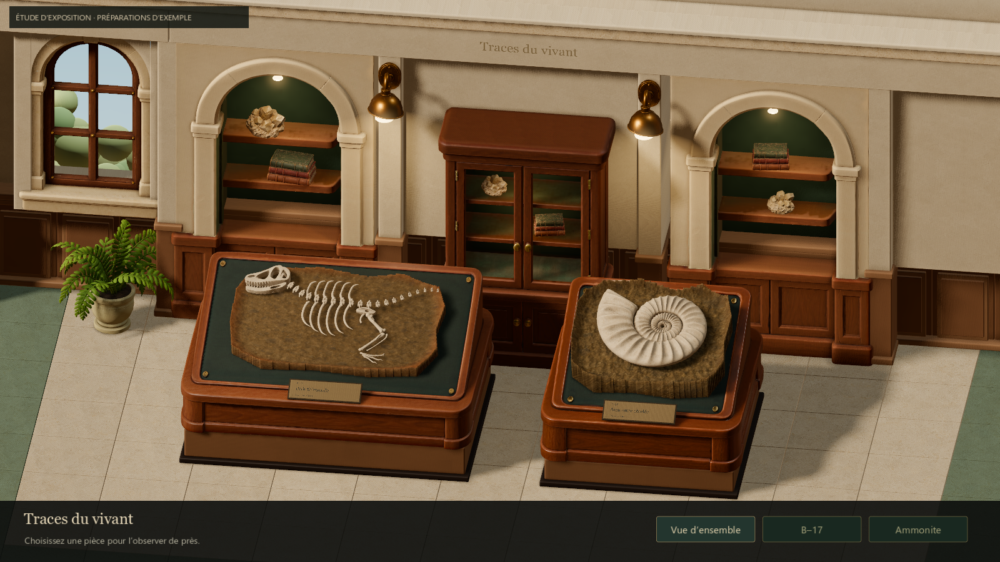
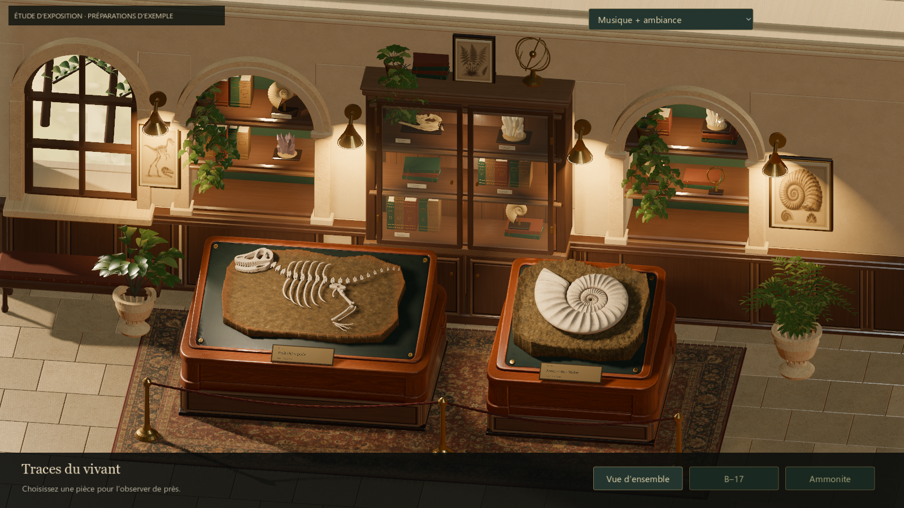
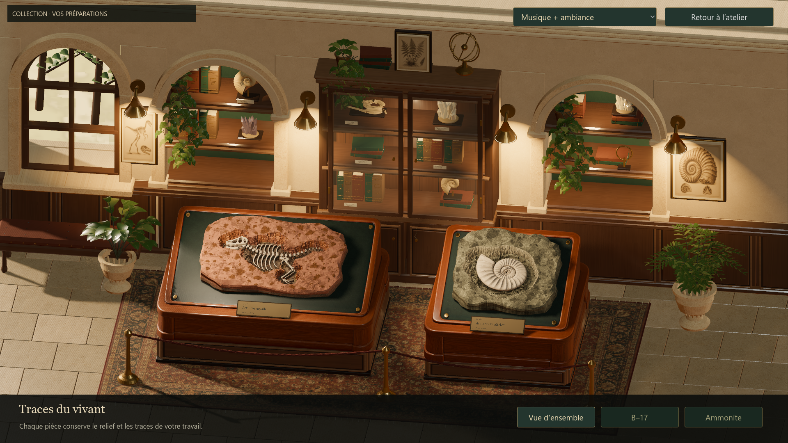

# Musée — finition visuelle, ambiance et souffleur

## Résultat et périmètre

Retour du 19 octobre : Antoine apprécie les matières et sons de la première
passe atelier, demande le retrait de la lampe visible, une salle d’exposition
bien plus aboutie selon sa nouvelle référence et une ambiance/musique dédiée.
Il autorise les assets originaux et des itérations après comparaison des captures.
La livraison prolonge la branche `codex/atelier-sensory-polish` et la PR draft
[#55](https://github.com/ezzerx/archaeology-game/pull/55), sans fusion.
Le statut et la prochaine action restent exclusivement dans `docs/brain/status.md`.

**Technical Artist** a reconstruit les alcôves, la vitrine, les boiseries,
le mobilier et les accessoires : livres, minéraux, coquilles, plantes courbes,
pots, armillaire, banc, cordons en laiton, tapis et gravures.
Les deux présentoirs existants sont conservés et mieux intégrés à leurs socles.
Deux textures originales imagegen apportent la trame du tapis et les gravures ;
leurs dimensions natives et prompts sont conservés avec les assets.

**Godot Shader Developer** a travaillé le noyer, la pierre et le laiton,
la lumière des niches et des appliques, les clés rasantes des pièces et
les contacts ombrés. La vue générale est légèrement plus large et haute pour
inclure les accessoires ; l’inspection et les commandes restent identiques.

**Game Audio Engineer** a ajouté une composition originale contemplative
(piano feutré et cordes, boucle de 84 s) et une ambiance de pièce de 48 s.
Deux lecteurs Vorbis suffisent. Le menu propose musique + ambiance, ambiance
seule et silence ; le choix est conservé. Les transitions atelier/musée sont
fondues et restaurent le gain après échec. Le bouton Retour reste inactif
jusqu’à la fin du chargement. Les sons des outils de la première passe restent.

La lampe visible est retirée des deux décors atelier. La lumière de travail
reste indépendante. Le souffleur est optimisé sans changer ses règles,
rayons, cadences, cartes, événements ni résultats de préparation.

## Comparaison visuelle et itérations

La référence du chat évoque un cabinet de curiosités : noyer sombre, pierre
crème, laiton chaud, feuilles retombantes et abondance d’objets scientifiques.
Elle sert de direction ; le rendu livré n’est pas présenté comme son équivalent
photoréaliste. Les blocs réellement préparés gardent leur géologie et leurs dégâts.

1. Capture de départ sur `99fa7fe`, puis première reconstruction. Rejet de la
   première passe : vitrine traversée par la paroi, corniche masquant des objets,
   feuillage trop anguleux, coquilles minces et alcôves trop ternes.
2. Reprise des ouvertures, vrais volumes et feuillages courbes, coquilles côtelées,
   lumière locale renforcée, socles moulurés. Le coût est réduit après cuisson
   d’une version initialement trop dense.
3. Fermeture des derniers raccords, lierre rattaché à des pots visibles, tapis
   tissé et gravures détaillées, réduction des reflets des clés de présentoir.
4. Captures natives finales inspectées par l’orchestrateur et les deux agents
   visuels, sur les vraies archives copiées et sur les exemples d’étude.
   Composition, ancrage des objets, lecture des pièces et cohérence des matières
   jugés suffisants pour soumission à Antoine. Les étagères, le jardin et le sol
   restent moins riches que la référence ; la grille du terrain demeure visible
   à très gros zoom. Cette revue d’équipe ne remplace pas le jugement humain.

Comparaison à exemples identiques, 1600 × 900 (le cadrage général est ajusté) :

| Avant | Après |
| --- | --- |
|  |  |

Vraies préparations sauvegardées, 1920 × 1080 :



Les deux séries ne sont pas interchangeables : les exemples d’étude sont
étiquetés comme tels, et le lanceur normal ouvre toujours la collection réelle.
Le musée vide ne reçoit aucun fossile de substitution.

## Budget et mesures natives

Godot 4.7.2 stable, RTX 5080. Atelier Compatibility ; musée Forward+.
Plafond de jeu 240 FPS, physique 60 Hz conservés. Les mesures de musée ci-dessous
sont déplafonnées, après stabilisation, sur copies des vraies archives.

- Décor original : **234 086 triangles / 39 lots opaques + un vitrage**, LOD cuits.
  Aucune génération de géométrie par image ni collision décorative ajoutée.
- Soleil + quatre ombres locales retenus : environ **+0,5 ms GPU** par rapport au
  soleil seul. Le compromis visuel a été examiné sur les vrais blocs.
- Musée final, ensemble 1080p : **image P50 4,662 ms / P95 5,193 ms**.
  La comparaison des ombres mesure environ 5,5 ms près du B–17 dense.
  Ces préparations ne maintiennent donc pas 240 FPS dans toutes les vues.
- Atelier, 1440 × 810, même parcours natif de quatre secondes de souffleur :

| Préparation | Avant, FPS moyens | Après, FPS moyens | P95 image avant → après |
| --- | ---: | ---: | ---: |
| Terre compacte | 236,0 | 236,5 | 10,287 → 10,500 ms |
| Marine dense | 141,8 | 178,7 | 17,516 → 16,364 ms |
| Concrétions | 210,4 | 219,5 | 13,704 → 13,057 ms |

Le cas marin gagne **26 % de FPS moyens** dans ce parcours. Cela ne résout pas
entièrement les pointes : le P95 reste autour de 16 ms en souffle dense.
Deux mesures CPU alternées sur une fixture ouverte donnent **3,64 ms** contre
**4,73 ms** pour l’implémentation précédente, soit environ 23 % de calcul en moins.
Les mesures courtes ne sont pas une garantie sur tout geste ou toute machine.

## Validation

- Ressources et scripts : 332 contrôles réussis.
- Stockage : 18 contrôles réussis ; les quatre fichiers du vrai répertoire joueur
  sont vérifiés par SHA-256 avant/après. Aucun fichier joueur n’est livré dans Git.
- Musée natif : 58 contrôles réussis (navigation, touches, molette, glisser,
  tailles de fenêtre, budget statique, trois modes audio et restauration du rendu).
- Vraies archives exposées : 12 contrôles réussis, dont rechargement du parcours
  marin et conservation des empreintes ; état vide : 4 contrôles réussis.
- Audio : 23 contrôles backend et 46 d’intégration réussis. Couverture du retour
  pendant chargement, deux échecs de transfert successifs et réentrée pendant
  restauration. Les erreurs de création de répertoire de ce dernier test sont
  provoquées volontairement pour vérifier la récupération.
- Souffleur : 1 680 comparaisons exactes entre l’oracle Git `99fa7fe`, la borne
  seule et l’optimisation ; 21 contrôles supplémentaires sur géologie marine réelle.
- Suivi de souris et parcours natif : 20 contrôles réussis.
- Rejeu différentiel à caméra contrôlée : 77 contrôles réussis en headless puis en natif Compatibility sur les
  trois familles et 14 étapes d’outils. Le vieux rejeu natif échoue sur quatre
  hashes de la terre compacte : sa caméra était interpolée selon le temps réel.
  Le même ancien code reproduit cette variation à 60/240 Hz ; aucune fixture
  ni tolérance n’a été modifiée. Voir [diagnostic](MUSEUM_REPLAY_DIAGNOSTIC.md).
- Passages natifs par les vrais handlers audio : atelier → musée en 4,37 s,
  musée → atelier en 7,61 s, relèves réussies, processus QA ensuite fermés.
  Les copies d’archives sont conservées ; les sources joueur restent intactes.

Les Ogg réellement livrés ont été décodés et vérifiés : durées, crêtes,
composante continue et raccords. L’audition locale est
`work/audio/museum/museum-audition.mp3`. Aucune écoute humaine du confort
musical ni mesure du mixeur natif n’est déduite des tests.
Les captures Forward+ signalent à la fermeture sept RID de texture encore
référencés ; aucune erreur de shader ou de chargement n’a été observée.

## Lancer et reproduire

- **`Launch-Museum-Polish.cmd`** : collection réelle, fenêtre 1600 × 900.
- `Launch-Museum-Polish.ps1 -Windowed -Study` : exemples d’étude explicitement
  étiquetés pour comparer la présentation.
- **`Launch-Atelier-Polish.cmd`** : atelier sans lampe et souffleur optimisé.

Avec Godot 4.7.2 et Git disponibles, depuis ce worktree :

```powershell
godot --headless --path . --script tests/run_runtime_resources.gd
godot --headless --path . --script tests/run_issue28_storage.gd
godot --headless --path . --script tests/run_museum_audio.gd
godot --headless --path . --script tests/run_museum_audio_integration.gd -- --qa --exhibit-store=res://work/audio/museum/integration-empty
godot --headless --path . --script tests/run_museum_blower_exact.gd -- --label=exact
godot --headless --path . --script tests/run_museum_replay_exact.gd -- --qa --distinction-store=res://work/museum-polish/replay-exact/distinctions.json
godot --path . --rendering-method forward_plus --script tests/run_issue51_gallery_native.gd -- --qa
godot --path . --rendering-method gl_compatibility --script tests/run_issue43_fluidity_native.gd -- --qa --label=after-museum-final --distinction-store=res://work/museum-polish/qa-distinctions.json
```

Les archives utilisées pour les captures sont des copies locales ignorées dans
`work/museum-polish/player-copy`. Ne jamais remplacer le répertoire joueur pour
reproduire un test. `tools/museum/capture_prepared_gallery.gd` accepte `--out=`
et `--exhibit-store=` pour isoler les images et le stockage.

Détails : [Technical Art](MUSEUM_TECHNICAL_ART_NOTES.md),
[shaders](MUSEUM_SHADER_NOTES.md), [audio](MUSEUM_AUDIO_NOTES.md),
[souffleur](MUSEUM_BLOWER_PERFORMANCE.md).
