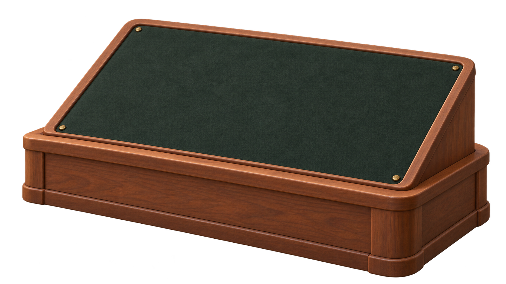
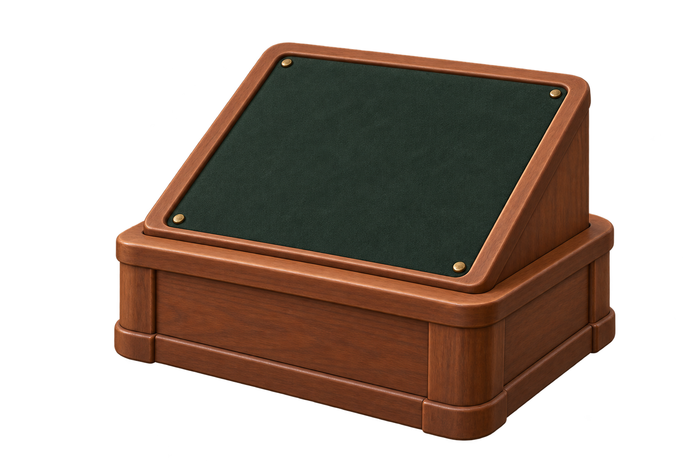
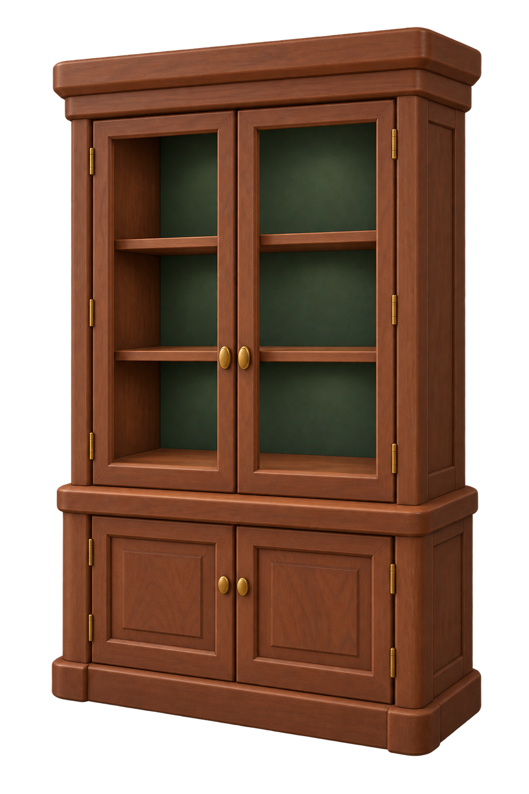
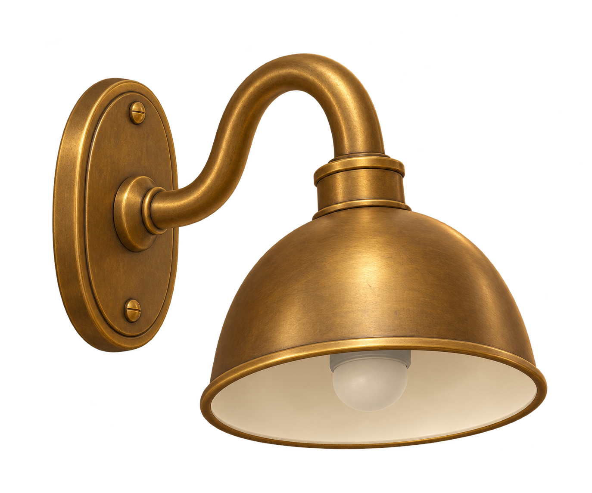

# Mobilier du musée — références pour Tripo

Références dérivées du second concept choisi par Antoine et du rendu validé
de la préparation. Images produites avec Imagegen intégré, puis revues.
Ce sont des références de génération, pas encore des modèles 3D ni des captures natives.

## Fichiers à utiliser

Une seule image par génération. Ces quatre fichiers montrent quatre objets
différents : ne pas les réunir dans un mode multivue.

| Ordre | Référence | Intention et intégration |
|---|---|---|
| 1 | [Présentoir B–17](01-presentoir-b17.png) | Pilote : grand lit incliné libre, noyer patiné, fond vert sombre ; vrai bloc ajouté dans Godot |
| 2 | [Présentoir ammonite](02-presentoir-ammonite.png) | Meuble compact de la même famille ; étudier aussi une adaptation locale du pilote |
| 3 | [Vitrine sans verre](03-vitrine-sans-verre.png) | Étagères vides et cadres ouverts ; ajouter les vitres séparément dans Godot |
| 4 | [Applique en laiton](04-applique-laiton.png) | Source lumineuse ajoutée dans Godot, ampoule représentée éteinte |

Les cartels et les fixations adaptées aux blocs seront ajoutés séparément.
Les dimensions finales se règlent à partir de nos modèles, pas de mesures
déduites de l'image. Les textures du mobilier doivent accompagner le grain,
les cassures et l'ivoire des préparations ; la lumière de studio n'est pas
une texture d'éclairage à conserver dans le jeu.

## 01 — Présentoir B–17

## 02 — Présentoir ammonite

## 03 — Vitrine

## 04 — Applique

## Premier essai dans Tripo Studio

1. Ouvrir [Tripo Studio](https://studio.tripo3d.ai/).
2. Choisir **Best Quality / HD Model** sur l'accueil, ou **3D Workspace → HD Model**.
   Charger uniquement `01-presentoir-b17.png`.
   Ce sont les libellés indiqués par [l'aide officielle](https://www.tripo3d.ai/help/features/how-to-use-the-image-to-3d-feature).
3. Appliquer la [fiche de réglages Studio du présentoir B–17](TRIPO_STUDIO_SETTINGS.md),
   établie à partir de l'écran fourni par Antoine et révisée pour privilégier
   une source détaillée avant optimisation. Les valeurs exactes sont dans la fiche.
   Utiliser l'image telle quelle, sans fossile ni décor. Une seule variante suffit.
   Ce sont des réglages recommandés, à évaluer sur le modèle obtenu.
4. Vérifier le coût affiché par Studio avant de lancer la génération. Les crédits
   Studio et API sont [distincts](https://www.tripo3d.ai/help/api-plugins/tripo-studiotripo-api).
   Le budget API ci-dessous ne prédit pas le prix Studio.
5. Examiner le résultat de face, de côté et de dos : plan du lit incliné régulier,
   cadre continu, base stable, absence de creux fondus ou d'objet parasite.
   Regarder aussi si le bois reste cohérent et si les ombres de l'image ont été
   exagérément intégrées à la texture.
6. Exporter en **GLB avec textures**. GLB est un format proposé par
   [Tripo](https://www.tripo3d.ai/help/getting-started/what-3d-file-formats-do-you-support).
   Nom conseillé : `museum_b17_stand_pilot.glb`. Conserver le modèle d'origine
   avant toute optimisation. Déposer les prochains fichiers dans
   `C:\Users\antoi\Documents\ArchaeologyGame-Assets\Tripo\museum`, puis indiquer
   leur nom dans le chat. [Stockage et provenance](../../../../assets/museum/source/README.md).

Les menus et options peuvent varier selon le compte. Éviter de multiplier les
générations pour corriger un détail que l'on peut reprendre dans Blender.
L'optimisation, les matériaux et les ajustements au bloc seront jugés dans Godot
avant de produire la suite du mobilier.

## Option API : simulation antérieure, non exécutée

Cette simulation visait un maillage déjà réduit. Elle précède la recommandation
Studio révisée pour une source détaillée : préparer un nouveau plan avant un
éventuel lancement API, sans réutiliser cette commande telle quelle.

Simulation CLI réussie : `valid: true`, aucune erreur ni avertissement.
La simulation n'a envoyé aucune génération et n'a consommé aucun crédit de génération.

- Entrée : `01-presentoir-b17.png`.
- Modèle : alias `tripo-v3.1`, valeur API `v3.1-20260211`.
- Une seule opération payante : `POST /v3/generation/image-to-model`.
- Paramètres : `smart_low_poly=true`, `face_limit=10000`,
  `texture_quality=detailed`, `texture=true`, `pbr=true`.
- Sorties attendues de la génération : GLB, aperçu et compte rendu de tâche.
  Pas de conversion FBX, rig, animation ni étape de retopologie séparée.
- Dossier de sortie CLI prévu : `assets/museum/source/tripo-out/<nom>-<id>/`.
  Le modèle destiné au runtime sera placé après inspection et retouches.

Estimation selon la [fiche H3.1 de l'API V3](https://developers.tripo3d.ai/en/models/v3-1) :
une génération image avec texture détaillée 40 crédits + smart low-poly 10 =
**environ 50 crédits API au total**. Le [barème historique de la plateforme](https://platform.tripo3d.ai/docs/billing)
présente une surcharge différente pour les textures détaillées ; garder une marge
jusqu'à **60 crédits** et confirmer le tarif avant exécution. Le montant réellement
facturé doit être relevé sur la tâche. Les tâches échouées sont remboursées selon
[l'aide API](https://docs.tripo3d.ai/other/support-faq.html).

Commande exacte testée, depuis la racine du dépôt :

~~~powershell
npx.cmd --yes tripo-cli@latest make docs/visual-references/museum/furniture/01-presentoir-b17.png --model tripo-v3.1 -p smart_low_poly=true -p face_limit=10000 -p texture_quality=detailed -p texture=true -p pbr=true --name museum-b17-stand-pilot -o assets/museum/source --dry-run --json
~~~

Tout lancement payant doit faire l'objet d'un accord sur cette opération et son
budget ; recharger un compte ne vaut pas à lui seul un accord pour lancer une série.
L'accès et le solde API sont vérifiés localement, sans conserver de donnée d'accès.

## Revue des images

- Quatre objets isolés, chaque pièce entièrement visible, sans fossile intégré.
- Cohérence du noyer, du vert sombre, des profils arrondis et du laiton.
- Vitrine sans verre et lampe éteinte pour séparer géométrie et rendu du moteur.
- PNG avec alpha ; dimensions, empreintes et sondes de transparence dans
  [manifest.json](manifest.json). Certains aperçus ignorant l'alpha peuvent montrer
  de la couleur dans le fond transparent ; les sondes extérieures ont une alpha nulle.
- Une tentative de détourage supplémentaire de l'ammonite n'a pas été retenue :
  après contrôle, le fichier initial possédait déjà la transparence attendue.
- Pas d'affirmation de multivue exacte, d'échelle métrique ou de topologie :
  ces propriétés devront être vérifiées sur le vrai modèle.

Prompts exacts et références : [prompts.json](prompts.json).
